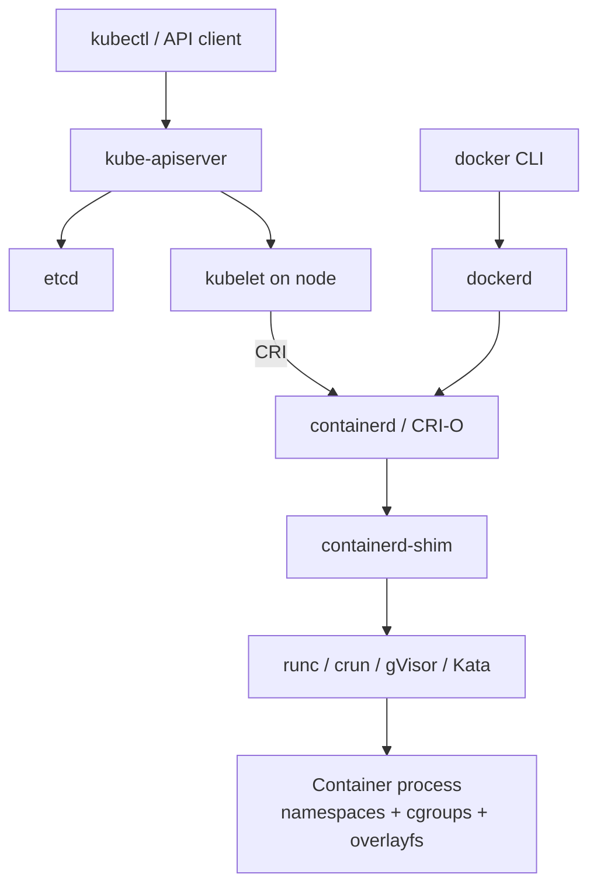
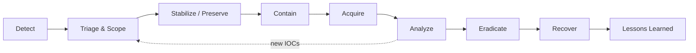

# DFIR in Containerized Environments

**Scope:** Docker, containerd, CRI-O, Kubernetes (self-managed, EKS, GKE, AKS), and serverless container platforms (Fargate, Cloud Run, ACI)
**Audience:** Incident responders, SOC analysts, and platform/security engineers
**Last updated:** 2026-09-30

---

## Table of Contents

1. [Why Container DFIR Is Different](#1-why-container-dfir-is-different)
2. [Forensic Architecture Primer](#2-forensic-architecture-primer)
3. [Threat Landscape and ATT&CK Mapping](#3-threat-landscape-and-attck-mapping)
4. [Preparation: Readiness Before the Incident](#4-preparation-readiness-before-the-incident)
5. [IR Workflow Overview](#5-ir-workflow-overview)
6. [Detection and Triage](#6-detection-and-triage)
7. [Containment Without Destroying Evidence](#7-containment-without-destroying-evidence)
8. [Evidence Acquisition](#8-evidence-acquisition)
9. [Analysis](#9-analysis)
10. [Container Escape Investigation](#10-container-escape-investigation)
11. [Kubernetes Control Plane Investigation](#11-kubernetes-control-plane-investigation)
12. [Managed and Serverless Platforms](#12-managed-and-serverless-platforms)
13. [Eradication and Recovery](#13-eradication-and-recovery)
14. [Tooling Reference](#14-tooling-reference)
15. [Checklists](#15-checklists)
16. [Appendix A: Node Triage Collection Script](#appendix-a-node-triage-collection-script)
17. [Appendix B: Hunting Queries](#appendix-b-hunting-queries)

---

## 1. Why Container DFIR Is Different

| Traditional host DFIR | Containerized DFIR |
|---|---|
| Long-lived hosts, stable disks | Ephemeral workloads; a pod may live for minutes |
| One OS = one investigation scope | Many isolated workloads share one kernel |
| "Pull the plug" / image the disk | Orchestrator may kill, reschedule, or scale-in the workload automatically |
| Logs on local disk | Logs on stdout/stderr, rotated by the runtime, often shipped off-node or lost |
| Identity = local/domain accounts | Identity = service accounts, cloud IAM roles, workload identity, kubeconfig |
| Persistence in the OS | Persistence in images, registries, manifests, admission webhooks, CronJobs, DaemonSets |

**Core principles:**

1. **Speed beats completeness.** Evidence can vanish at any moment (restart, eviction, autoscaler). Stabilize first.
2. **Never trust binaries inside the container.** Use host tools via `nsenter` or `/proc/<pid>/root`.
3. **Investigate three layers:** workload (container/pod) → node (host kernel, runtime) → control plane (API server, cloud account).
4. **The image is evidence.** Record the exact digest (`sha256:…`), not the tag.
5. **Do not `kubectl delete`, `kubectl drain`, or `docker rm` a compromised workload** until acquisition is done.

---

## 2. Forensic Architecture Primer

### 2.1 Runtime stack



### 2.2 Isolation primitives relevant to forensics

| Primitive | What it isolates | Forensic relevance |
|---|---|---|
| PID namespace | Process tree | Container PIDs differ from host PIDs; map via `/proc/<pid>/status` (`NSpid`) |
| Mount namespace | Filesystem view | Access container FS from host via `/proc/<host_pid>/root/` |
| Network namespace | Interfaces, sockets | Inspect with `nsenter -t <pid> -n` using host tools |
| User namespace | UID mapping | UID 0 inside may be unprivileged on host (if enabled) |
| cgroups | Resource limits | CPU spikes = mining; cgroup path identifies container |
| Capabilities / seccomp / AppArmor / SELinux | Syscall and privilege limits | Missing or weakened profiles = escape precondition |

### 2.3 Filesystem layout (overlayfs)

A container's root FS = read-only image layers (**lowerdir**) + one writable layer (**upperdir**). **All runtime changes made by the attacker live in the upperdir**, which is deleted when the container is removed.

| Runtime | Default data root | Writable layer location |
|---|---|---|
| Docker | `/var/lib/docker/` | `/var/lib/docker/overlay2/<id>/diff` |
| containerd | `/var/lib/containerd/` | `/var/lib/containerd/io.containerd.snapshotter.v1.overlayfs/snapshots/<n>/fs` |
| CRI-O / Podman | `/var/lib/containers/storage/` | `/var/lib/containers/storage/overlay/<id>/diff` |

Deleted files from lower layers appear in the upperdir as **whiteout** files (character device 0/0) — these reveal attacker deletions of image content.

### 2.4 Key node artifacts

| Artifact | Location |
|---|---|
| Container stdout/stderr (K8s) | `/var/log/pods/<ns>_<pod>_<uid>/<container>/<n>.log` (symlinked from `/var/log/containers/`) |
| Docker container logs (json-file driver) | `/var/lib/docker/containers/<id>/<id>-json.log` |
| Docker container config | `/var/lib/docker/containers/<id>/config.v2.json`, `hostconfig.json` |
| containerd metadata DB | `/var/lib/containerd/io.containerd.metadata.v1.bolt/meta.db` |
| Running task bundle (containerd) | `/run/containerd/io.containerd.runtime.v2.task/k8s.io/<id>/` (includes `config.json` OCI spec, `rootfs/`) |
| kubelet / runtime logs | `journalctl -u kubelet`, `-u containerd`, `-u docker`, `-u crio` |
| Static pod manifests | `/etc/kubernetes/manifests/` |
| kubelet config and credentials | `/var/lib/kubelet/config.yaml`, `/var/lib/kubelet/pki/`, `/etc/kubernetes/kubelet.conf` |
| Kubelet checkpoints | `/var/lib/kubelet/checkpoints/` |
| Mounted SA tokens / secrets | `/var/lib/kubelet/pods/<uid>/volumes/` |

---

## 3. Threat Landscape and ATT&CK Mapping

### 3.1 Common attack paths

1. **Exploited application** in a public-facing container → shell → discovery → credential theft (SA token, cloud IMDS) → lateral movement.
2. **Exposed management API** (Docker API on 2375/tcp, unauthenticated kubelet 10250, Kubernetes dashboard, anonymous API server access) → deploy malicious container.
3. **Supply chain**: poisoned public image, compromised base image, typosquatted image, malicious Helm chart, compromised CI pipeline pushing to the registry.
4. **Stolen credentials**: leaked kubeconfig, CI tokens, cloud keys with cluster admin.
5. **Container escape** via privileged configuration or kernel/runtime vulnerability → node → other workloads, node credentials, cloud role.

### 3.2 MITRE ATT&CK (Containers matrix) highlights

| Tactic | Technique | Typical evidence |
|---|---|---|
| Initial Access | T1190 Exploit Public-Facing Application | App logs, WAF/ingress logs, child shells of app process |
| Initial Access | T1078 Valid Accounts | API audit logs with unusual source IP/user agent |
| Execution | T1609 Container Administration Command | `pods/exec`, `pods/attach`, `docker exec` events |
| Execution | T1610 Deploy Container | `create` on pods/deployments/daemonsets from unexpected identity |
| Persistence | T1053.007 Container Orchestration Job | New CronJobs/Jobs |
| Persistence | T1525 Implant Internal Image | New/overwritten tags in registry, digest mismatch |
| Privilege Escalation | T1611 Escape to Host | Privileged pods, hostPath `/`, `nsenter -t 1`, `release_agent` writes |
| Defense Evasion | T1612 Build Image on Host | `docker build` on nodes, unexpected local images |
| Credential Access | T1552.007 Container API | Reads of SA tokens, secrets `list`/`get` |
| Credential Access | T1552.005 Cloud Instance Metadata API | Connections to `169.254.169.254` from pods |
| Discovery | T1613 Container and Resource Discovery | `list` on pods/nodes/secrets across namespaces, `kubectl auth can-i` |
| Impact | T1496 Resource Hijacking | CPU saturation, mining pool connections, xmrig binaries |

### 3.3 Notable runtime/kernel vulnerabilities to consider

| CVE | Component | Impact |
|---|---|---|
| CVE-2019-5736 | runc | Overwrite host runc binary → host root |
| CVE-2022-0185 | Linux kernel (fs_context) | Heap overflow → escape (needs `CAP_SYS_ADMIN` in userns) |
| CVE-2022-0492 | Linux kernel (cgroup v1) | `release_agent` abuse → escape |
| CVE-2024-21626 | runc ("Leaky Vessels") | Leaked FD / `WORKDIR` → host FS access |
| CVE-2025-1974 | ingress-nginx ("IngressNightmare") | Unauthenticated RCE in admission controller → cluster secrets |

Always record node kernel version (`uname -a`), runtime versions (`runc --version`, `containerd --version`), and Kubernetes version for vulnerability correlation.

---

## 4. Preparation: Readiness Before the Incident

Most container investigations fail because the telemetry never existed. Minimum readiness:

### 4.1 Logging

- [ ] **Kubernetes API audit logging** enabled with a policy that logs at least `Metadata` for everything and `RequestResponse` for RBAC, secrets (metadata only), `pods/exec`, `pods/attach`, `pods/portforward`, and workload creation. Ship off-cluster.
- [ ] Managed clusters: enable control-plane log export (EKS `audit`/`authenticator`, GKE Cloud Audit Logs incl. Data Access, AKS `kube-audit`/`kube-audit-admin`).
- [ ] **Container stdout/stderr** shipped to central logging (Fluent Bit, Vector, OTel Collector) with pod/namespace/node/image metadata.
- [ ] **Node logs**: journald (kubelet, runtime), auditd, syslog shipped off-node.
- [ ] **Cloud logs**: CloudTrail / Cloud Audit Logs / Azure Activity Log, VPC/NSG flow logs, DNS logs.
- [ ] **Registry logs**: push/pull/delete events.
- [ ] Retention ≥ 90 days for audit trails (align with regulatory requirements).

### 4.2 Runtime detection

Deploy an eBPF-based runtime sensor on every node: **Falco**, **Tetragon**, **Tracee**, or a commercial CWPP/XDR (e.g., Cortex XDR/Cloud, Defender for Containers, Sysdig Secure, Wiz Runtime). Required coverage:

- Process execution with full container/pod context
- File writes to sensitive paths (`/etc`, `/root/.ssh`, binaries)
- Network connections (incl. IMDS, mining pools)
- Namespace changes (`setns`, `unshare`), `mount`, module loading, `ptrace`

### 4.3 Forensic capability

- [ ] Pre-approved **forensic toolkit image** (static binaries: `avml`, `crictl`, `nerdctl`, `jq`, `tcpdump`, `sha256sum`) stored in an internal, signed registry.
- [ ] Pre-approved **privileged debug pod** manifest (restricted to the IR group via RBAC) for node access where SSH is disabled.
- [ ] **Kubelet checkpoint API** (`ContainerCheckpoint` feature gate, beta and enabled by default since K8s 1.30) tested with your runtime (CRI-O, or containerd ≥ 2.0).
- [ ] Node **disk snapshot** runbook for each cloud (EBS snapshot, GCE PD snapshot, Azure managed disk snapshot).
- [ ] Linux memory **symbol tables** (ISF) for Volatility 3 prepared for each node image/kernel version in use.
- [ ] **Quarantine NetworkPolicy** template and verified CNI enforcement (Calico, Cilium, etc.).
- [ ] Isolated **forensic account/project/subscription** to receive snapshots and artifacts.
- [ ] Break-glass IR identity with read access across clusters.

### 4.4 Hardening that also improves forensics

- Pin images by **digest**; enforce signatures (cosign/Notation) via admission control (Kyverno, Gatekeeper, Sigstore policy-controller).
- Pod Security Admission `restricted` where possible; `readOnlyRootFilesystem: true` makes any write anomalous.
- Block IMDS from pods (IMDSv2 hop limit 1 on AWS, GKE Workload Identity/metadata concealment, AKS Workload Identity).
- Disable automounting SA tokens where not needed (`automountServiceAccountToken: false`).

---

## 5. IR Workflow Overview



**Order of volatility (containers):**

1. Container process memory and node RAM
2. Network state (connections, sockets, routing in the netns)
3. Running process tree, open files, environment variables
4. Container writable layer (upperdir) — lost on container removal
5. Container stdout/stderr logs on node — lost on rotation/pod deletion
6. Kubernetes object state (pod spec, events — events expire after ~1h by default)
7. Node disk
8. Images in registry, control plane audit logs, cloud logs

> **Kubernetes Events expire (default TTL 1 hour).** Export `kubectl get events -A` immediately.

---

## 6. Detection and Triage

### 6.1 Common detection signals

- Runtime alert: shell spawned in container, package manager run at runtime, binary written and executed, `nsenter`/`mount`/`chroot` inside container.
- Unexpected outbound traffic: mining pools (ports 3333, 4444, 5555, 14444, stratum+tcp), Tor, paste sites, IMDS.
- API audit: `pods/exec` by unusual identity, secret enumeration, new `ClusterRoleBinding` to `cluster-admin`, anonymous requests, privileged pod creation.
- Cloud: API calls from node/workload role that the workload never makes; calls from IPs outside the cluster egress.
- Resource: sustained 100% CPU on pods/nodes.

### 6.2 Initial scoping questions

1. Which **cluster, namespace, pod, container, node** and **image digest**?
2. Which **identities** are attached: Kubernetes SA, its RBAC, cloud role (IRSA/Pod Identity, GKE WI, AKS WI), node role?
3. Is the workload **privileged** or has host mounts/namespaces? (Escape risk → scope expands to node.)
4. What secrets/volumes are mounted?
5. Is the same image running elsewhere? (Supply-chain scope.)
6. Is there evidence of API server interaction from the workload?

### 6.3 Quick triage commands (read-only)

```bash
NS=<namespace>; POD=<pod>

# Pod spec, status, owner, node, image digests
kubectl -n $NS get pod $POD -o yaml > pod_${POD}.yaml
kubectl -n $NS get pod $POD -o jsonpath='{range .status.containerStatuses[*]}{.name}{"\t"}{.imageID}{"\t"}{.containerID}{"\n"}{end}'
kubectl -n $NS describe pod $POD > describe_${POD}.txt

# Events before they expire
kubectl get events -A --sort-by=.lastTimestamp -o wide > events_all.txt

# Identity and permissions of the pod's service account
SA=$(kubectl -n $NS get pod $POD -o jsonpath='{.spec.serviceAccountName}')
kubectl -n $NS get sa $SA -o yaml
kubectl auth can-i --list --as=system:serviceaccount:$NS:$SA > sa_permissions.txt

# Current and previous container logs
kubectl -n $NS logs $POD --all-containers --timestamps > logs_current.txt
kubectl -n $NS logs $POD --all-containers --timestamps --previous > logs_previous.txt 2>&1
```

> Avoid `kubectl exec` into a suspect container for triage — it runs attacker-controllable binaries, creates new processes in the evidence, and may tip off the attacker. Prefer node-side inspection (Section 8.3).

### 6.4 Cluster-wide risky workload sweep

```bash
kubectl get pods -A -o json | jq -r '
  .items[]
  | select(
      any(.spec.containers[]; .securityContext.privileged == true)
      or .spec.hostPID == true
      or .spec.hostNetwork == true
      or .spec.hostIPC == true
      or any(.spec.volumes[]?; .hostPath != null)
    )
  | "\(.metadata.namespace)/\(.metadata.name)\tnode=\(.spec.nodeName)"'
```

---

## 7. Containment Without Destroying Evidence

### 7.1 Things NOT to do first

| Action | Why it hurts |
|---|---|
| `kubectl delete pod` | Destroys writable layer, process memory, and node-local logs |
| `kubectl drain <node>` | Evicts (deletes) all pods on the node |
| `kubectl rollout restart` / redeploy | Replaces the compromised pods |
| `docker rm` / `docker system prune` | Removes container and layers |
| Rebooting the node | Loses memory and all running state |
| Letting cluster autoscaler scale in | Node gets terminated |

### 7.2 Kubernetes containment sequence

```bash
NS=<namespace>; POD=<pod>; NODE=<node>

# 1. Protect node from autoscalers
kubectl annotate node $NODE cluster-autoscaler.kubernetes.io/scale-down-disabled=true --overwrite
kubectl annotate node $NODE karpenter.sh/do-not-disrupt=true --overwrite   # if Karpenter
kubectl annotate pod -n $NS $POD karpenter.sh/do-not-disrupt=true --overwrite

# 2. Prevent new workloads from scheduling on the node
kubectl cordon $NODE

# 3. Detach pod from its controller and Service (controller spawns a clean replacement,
#    suspect pod is preserved as an orphan). Replace "app" with the actual selector key(s).
kubectl -n $NS label pod $POD app- quarantine=true --overwrite

# 4. Network isolation (requires a CNI that enforces NetworkPolicy)
cat <<'EOF' | kubectl apply -f -
apiVersion: networking.k8s.io/v1
kind: NetworkPolicy
metadata:
  name: ir-quarantine
  namespace: <namespace>
spec:
  podSelector:
    matchLabels:
      quarantine: "true"
  policyTypes: ["Ingress", "Egress"]
EOF
```

**Notes:**
- Verify the selector labels first: `kubectl -n $NS get rs,deploy -o wide` and compare with pod labels.
- Some CNIs do not terminate **already established** connections when a policy is applied. Verify with `nsenter -t <pid> -n ss -tanp` and, if needed, add node-level/cloud-level blocks (security group, firewall rule) for the node.
- For **escape suspected**: isolate the whole node at the cloud layer (restrictive security group / firewall tag) while keeping it running.

### 7.3 Identity containment

| Credential | Action |
|---|---|
| Kubernetes SA (bound, projected token) | Remove/restrict RBAC bindings for the SA; deleting and recreating the SA invalidates its bound tokens |
| Legacy SA token Secret | Delete the Secret (invalidates token) |
| Cloud workload identity (IRSA/Pod Identity, GKE WI, AKS WI) | Remove role binding or add explicit deny; revoke active sessions (AWS: `aws:TokenIssueTime` deny policy) |
| Node IAM role | Revoke sessions if IMDS abuse suspected |
| User kubeconfig / OIDC | Disable user at IdP, revoke refresh tokens, rotate client certs (cert-based creds cannot be revoked individually — rotate CA if cluster-admin cert leaked) |
| Secrets mounted in the pod | Treat as compromised; rotate at source (DB passwords, API keys) |

> Capture a copy of RBAC state **before** changing it (Section 8.6).

### 7.4 Docker (standalone host) containment

```bash
CID=<container_id>
docker network disconnect <network> $CID    # isolate from networks (repeat per network)
docker pause $CID                           # freeze processes via cgroup freezer; memory preserved
docker update --restart=no $CID             # prevent restart policies from interfering
```

`docker pause` stops execution without losing memory. Unpause briefly only if you need live network/process data you have not yet captured.

---

## 8. Evidence Acquisition

### 8.1 General rules

- Write evidence to **external storage** (mounted forensic volume, S3/GCS/Blob bucket in a forensic account), never to the node's container storage.
- **Hash everything** (`sha256sum`) at collection time; record UTC timestamps, collector, tool versions, commands run.
- Record node **clock skew** (`timedatectl`, `chronyc tracking`).
- Prefer **host-side** collection using trusted static binaries.

### 8.2 Get to the node

| Situation | Method |
|---|---|
| SSH/SSM/IAP available | Standard access |
| No SSH (managed nodes) | `kubectl debug node/<node> -it --image=<trusted-forensic-image> --profile=sysadmin` → host FS at `/host`; use `chroot /host` |
| Bottlerocket / COS / Talos | Use the vendor admin container/API or disk snapshot; no general shell |
| Fargate / Cloud Run / ACI | No node access — see Section 12 |

> `kubectl debug node` creates a new pod on the node. It is recorded in audit logs — document it as a responder action.

### 8.3 Identify the container's host PID

```bash
# containerd / CRI-O
crictl ps -a --name <container_name>
crictl inspect <container_id> | jq '.info.pid'

# Docker
docker inspect -f '{{.State.Pid}}' <container_id>

# Map from a host PID back to a container
cat /proc/<pid>/cgroup
grep NSpid /proc/<pid>/status
```

### 8.4 Live volatile collection (host-side)

```bash
PID=<host_pid>; OUT=/mnt/evidence/$(hostname)_${PID}_$(date -u +%Y%m%dT%H%M%SZ); mkdir -p $OUT

# Process tree within the container's PID namespace
ps -eo pid,ppid,user,lstart,cmd --forest > $OUT/ps_host_forest.txt
for p in $(ls /proc | grep -E '^[0-9]+$'); do
  [ "$(readlink /proc/$p/ns/pid 2>/dev/null)" = "$(readlink /proc/$PID/ns/pid)" ] && echo $p
done > $OUT/container_pids.txt

# Per-process details
while read p; do
  d=$OUT/proc/$p; mkdir -p $d
  cat /proc/$p/cmdline | tr '\0' ' ' > $d/cmdline
  tr '\0' '\n' < /proc/$p/environ > $d/environ 2>/dev/null
  readlink /proc/$p/exe > $d/exe_path
  cp /proc/$p/exe $d/exe.bin 2>/dev/null          # recovers deleted binaries too
  ls -la /proc/$p/fd > $d/fd.txt 2>/dev/null
  cat /proc/$p/maps > $d/maps 2>/dev/null
  cat /proc/$p/status > $d/status
done < $OUT/container_pids.txt

# Network state using HOST binaries inside the container netns
nsenter -t $PID -n ss -tanup  > $OUT/net_sockets.txt
nsenter -t $PID -n ip addr     > $OUT/net_addr.txt
nsenter -t $PID -n ip route    > $OUT/net_route.txt
cat /proc/$PID/net/arp         > $OUT/net_arp.txt

# Capabilities / security context
grep -E 'Cap(Inh|Prm|Eff|Bnd|Amb)|Seccomp|NoNewPrivs' /proc/$PID/status > $OUT/security_status.txt

# Short packet capture in the container netns (bounded)
timeout 120 nsenter -t $PID -n tcpdump -i any -w $OUT/capture.pcap -c 50000

sha256sum -r $OUT/**/* 2>/dev/null > $OUT/SHA256SUMS
```

`/proc/<pid>/environ` often contains secrets — handle the output as sensitive.

### 8.5 Memory acquisition

| Scope | Method |
|---|---|
| Whole node | `avml /mnt/evidence/<node>.lime` (AVML supports compressed output with `--compress`) or LiME kernel module |
| Single process | `gcore -o /mnt/evidence/core <pid>` (from host), or read `/proc/<pid>/mem` using ranges from `/proc/<pid>/maps` |
| Whole container (CRIU) | Kubelet checkpoint API or `docker checkpoint create` (see 8.7) |

Analyze node memory with **Volatility 3** Linux plugins (`linux.pslist`, `linux.pstree`, `linux.bash`, `linux.lsof`, `linux.sockstat`, `linux.malfind`, `linux.check_modules`). You need an ISF symbol file matching the exact node kernel (build with `dwarf2json` from the kernel debug symbols).

### 8.6 Kubernetes object state

```bash
OUT=/mnt/evidence/k8s_$(date -u +%Y%m%dT%H%M%SZ); mkdir -p $OUT

# Everything namespaced (excluding secret values)
for r in $(kubectl api-resources --verbs=list --namespaced -o name | grep -v '^secrets$'); do
  kubectl get "$r" -A -o yaml > "$OUT/ns_${r}.yaml" 2>/dev/null
done
# Cluster-scoped
for r in $(kubectl api-resources --verbs=list --namespaced=false -o name); do
  kubectl get "$r" -o yaml > "$OUT/cluster_${r}.yaml" 2>/dev/null
done

# Secrets: metadata only (names, types, timestamps, annotations)
kubectl get secrets -A -o json | jq '[.items[] | {ns:.metadata.namespace, name:.metadata.name, type:.type, created:.metadata.creationTimestamp, annotations:.metadata.annotations}]' > $OUT/secrets_metadata.json

kubectl get events -A -o yaml > $OUT/events.yaml
kubectl version -o yaml > $OUT/version.yaml
sha256sum $OUT/* > $OUT/SHA256SUMS
```

Priority objects: `pods`, `deployments`, `daemonsets`, `statefulsets`, `jobs`, `cronjobs`, `clusterroles`, `clusterrolebindings`, `roles`, `rolebindings`, `serviceaccounts`, `mutatingwebhookconfigurations`, `validatingwebhookconfigurations`, `networkpolicies`, `nodes`, CRDs.

**etcd snapshot** (self-managed clusters only): `etcdctl snapshot save` gives a point-in-time copy of all cluster state, including Secrets. Store encrypted with strict access control.

### 8.7 Container filesystem and checkpoint acquisition

**Option A — Kubelet checkpoint (full process state + FS, CRIU-based):**

```bash
# From a node or with access to kubelet API (port 10250), using kubelet client certs
curl -sk -X POST \
  --cert /etc/kubernetes/pki/apiserver-kubelet-client.crt \
  --key  /etc/kubernetes/pki/apiserver-kubelet-client.key \
  "https://<node-ip>:10250/checkpoint/<namespace>/<pod>/<container>"
# Output: /var/lib/kubelet/checkpoints/checkpoint-<pod>_<ns>-<container>-<timestamp>.tar
```

Inspect with `checkpointctl show <archive>` / `checkpointctl inspect <archive>`. The container keeps running after checkpointing. Certificate paths vary by distribution.

**Option B — Docker:**

```bash
CID=<container_id>
docker inspect $CID > inspect.json
docker diff $CID > diff.txt                    # A=added, C=changed, D=deleted vs image
docker export $CID -o container_fs.tar         # full merged FS (no image metadata)
docker logs --timestamps $CID > stdout_stderr.log 2>&1
docker inspect -f '{{.GraphDriver.Data.UpperDir}}' $CID   # writable layer path
```

`docker commit` is an alternative but creates a new image on the host (modifies host state) — prefer `export` + upperdir copy.

**Option C — containerd / CRI-O (Kubernetes nodes):**

```bash
CID=<container_id>; PID=$(crictl inspect $CID | jq '.info.pid')

# Writable layer: find upperdir from the mount table
grep -E "overlay.*$CID|upperdir" /proc/$PID/mountinfo | head
# Or from the task bundle
cat /run/containerd/io.containerd.runtime.v2.task/k8s.io/$CID/config.json > oci_spec.json

# Merged view through the process's root (host tools, read-only copy)
tar -C /proc/$PID/root -cpf /mnt/evidence/${CID}_merged_fs.tar --numeric-owner .

# Writable layer only (upperdir path from mountinfo)
tar -C <upperdir_path> -cpf /mnt/evidence/${CID}_upperdir.tar --numeric-owner .

crictl inspect $CID > crictl_inspect.json
crictl inspectp <pod_id> > crictl_inspectp.json
```

For a large merged FS, prioritize the **upperdir**; the lower layers can be reconstructed from the image digest.

### 8.8 Image acquisition

```bash
# Record exact digest from pod status (.status.containerStatuses[].imageID)
DIGEST=registry.example.com/app@sha256:<digest>

skopeo copy docker://$DIGEST oci-archive:/mnt/evidence/image.oci.tar
skopeo inspect --raw docker://$DIGEST > manifest.json

# From node cache (containerd)
ctr -n k8s.io images export /mnt/evidence/image.tar <image_ref>

# Docker
docker save <image@digest> -o /mnt/evidence/image.tar
```

Also collect registry audit logs and tag history — an attacker may have overwritten a tag.

### 8.9 Node disk

Take a **cloud disk snapshot** of the node's root and data volumes (EBS / PD / managed disk) and share/copy it to the forensic account. Attach to a forensic workstation read-only and analyze with `container-explorer`, `docker-explorer`, or by mounting overlay layers manually. For on-prem nodes, image with `dd`/`dc3dd`/`ewfacquire` after memory capture.

### 8.10 Control plane and cloud logs

Export the relevant window (incident start minus at least 7 days) of:
- Kubernetes audit logs
- Authenticator logs (EKS), IdP sign-in logs
- CloudTrail / Cloud Audit Logs / Azure Activity + Entra sign-in logs
- VPC/flow logs, DNS query logs, load balancer/ingress logs
- Registry logs, CI/CD pipeline logs

---

## 9. Analysis

### 9.1 Filesystem analysis of the writable layer

Focus: **everything in the upperdir is a change since container start.**

```bash
mkdir upper && tar -xpf <cid>_upperdir.tar -C upper

# Timeline of modified files
find upper -printf '%TY-%Tm-%Td %TT\t%s\t%m\t%u\t%p\n' | sort > upper_timeline.tsv

# Whiteouts = files deleted from image layers
find upper -type c -perm 000 -printf '%p\n' 2>/dev/null
find upper -name '.wh.*'

# Executables and scripts dropped at runtime
find upper -type f \( -perm -u+x -o -name '*.sh' -o -name '*.py' -o -name '*.so' \) -ls

# Common attacker locations
ls -la upper/tmp upper/var/tmp upper/dev/shm upper/root upper/etc 2>/dev/null
cat upper/root/.bash_history upper/home/*/.bash_history 2>/dev/null
```

Look for: miners (`xmrig`, `config.json` with pool URLs), reverse shells, `.ssh/authorized_keys`, modified `/etc/passwd` / `/etc/ld.so.preload`, cron entries, credential files, tooling (`kubectl`, `curl`, `nmap`, `deepce`, `peirates`, `cdk`), downloaded archives.

Hash suspicious files and check against threat intel (VirusTotal, MISP). Run YARA against the upperdir and memory.

### 9.2 Image analysis

```bash
# Layer-by-layer contents and history
dive <image>                                # interactive
skopeo inspect --config docker://$DIGEST     # entrypoint, env, history, labels

# SBOM and vulnerabilities
syft $DIGEST -o spdx-json > sbom.json
trivy image --scanners vuln,secret,misconfig $DIGEST
grype sbom:sbom.json

# Provenance / signature
cosign verify --certificate-identity-regexp '<expected>' --certificate-oidc-issuer '<issuer>' $DIGEST
cosign verify-attestation --type slsaprovenance $DIGEST
```

Questions to answer:
- Does the running digest match what CI built and signed?
- Do layers contain unexpected binaries, `RUN curl … | sh`, or embedded secrets?
- When was the tag last pushed, and by whom?

### 9.3 Log analysis

- **Container stdout/stderr:** exploit payloads, stack traces, suspicious user agents, command output.
- **kubelet journal:** container starts/stops, probe failures, image pulls, exec sessions (`journalctl -u kubelet --since … | grep -Ei 'exec|pull|killing|started'`).
- **Runtime journal:** container lifecycle, OCI errors associated with escape attempts.
- **Node auditd / eBPF telemetry:** `execve`, `setns`, `mount`, `init_module`, `ptrace`.

### 9.4 Timeline construction

Combine into a single UTC super-timeline:

| Source | Timestamp fields |
|---|---|
| K8s audit | `requestReceivedTimestamp`, `stageTimestamp` |
| Pod status | `creationTimestamp`, `status.startTime`, `containerStatuses[].state.*.startedAt` |
| Docker inspect | `.Created`, `.State.StartedAt`, `.State.FinishedAt` |
| Upperdir | file mtime/ctime (note: ctime reflects extraction time if copied without preserving) |
| Runtime sensor | event time |
| Cloud audit | event time |
| Flow / DNS logs | connection/query time |

Plaso (`log2timeline.py`) can parse Docker JSON artifacts and standard Linux logs from a node disk image; merge with API audit exports via Timesketch.

### 9.5 Identity and lateral movement analysis

1. From the pod's SA, enumerate **every API call** made by `system:serviceaccount:<ns>:<sa>` in the audit logs during the incident window.
2. Check for token use **outside** the cluster: same SA identity with `sourceIPs` not in pod/node CIDRs.
3. For cloud workload identity, pivot to cloud audit logs by role session name / principal and check source IPs and API calls (e.g., `sts:AssumeRole*`, `s3:GetObject`, `secretsmanager:GetSecretValue`, `iam:*`).
4. Check IMDS access (flow logs / eBPF to `169.254.169.254`) → node role abuse.
5. Map reachable services from the pod network (NetworkPolicies, Services, cloud firewall) to scope potential lateral movement.

---

## 10. Container Escape Investigation

### 10.1 Preconditions to check in the pod spec / runtime config

| Precondition | Where to look |
|---|---|
| `privileged: true` | pod spec `securityContext`, `docker inspect .HostConfig.Privileged` |
| Dangerous capabilities (`SYS_ADMIN`, `SYS_PTRACE`, `SYS_MODULE`, `DAC_READ_SEARCH`, `NET_ADMIN`) | spec `capabilities.add`, `/proc/<pid>/status` `CapEff` (decode with `capsh --decode=`) |
| `hostPID`, `hostNetwork`, `hostIPC` | pod spec |
| hostPath mounts (`/`, `/etc`, `/var/run/docker.sock`, `/run/containerd/containerd.sock`, `/var/lib/kubelet`, `/proc`) | pod spec `volumes`, `.Mounts` |
| Seccomp `Unconfined`, AppArmor `unconfined` | spec, `/proc/<pid>/status` `Seccomp: 0` |
| `allowPrivilegeEscalation: true`, running as root | spec |
| Vulnerable kernel / runc | node versions vs. CVEs in 3.3 |

### 10.2 Escape indicators

- `nsenter -t 1 -m -u -i -n -p` or `setns` into PID 1's namespaces
- `mount /dev/sd*`, `/dev/nvme*`, `/dev/xvd*` inside a container
- Writes to `release_agent`, `notify_on_release` in cgroup v1 hierarchies
- Writes to `/proc/sys/kernel/core_pattern` or `/sys/kernel/uevent_helper`
- Docker/containerd socket usage from inside a container (`curl --unix-socket /var/run/docker.sock`)
- Host `runc` binary modification (hash vs. package: `rpm -V runc` / `dpkg -V runc` / `debsums`)
- New processes on the host whose parent chain leads to a container shim but whose namespaces are the host's
- New files on the host FS (cron, systemd units, `authorized_keys`, `/etc/kubernetes/manifests/*.yaml`) with mtimes matching the container activity
- Kernel module loads (`dmesg`, `lsmod`, `linux.check_modules` in memory)

### 10.3 If escape is confirmed

- Scope expands to **the node and everything on it**: all pods, mounted secrets, kubelet credentials, node cloud role.
- Kubelet credentials allow reading secrets of pods scheduled on the node (and more if NodeRestriction admission is disabled).
- Treat node as fully compromised; plan replacement, not cleaning.
- Hunt for the same TTPs across all nodes.

---

## 11. Kubernetes Control Plane Investigation

### 11.1 High-value audit log patterns

| Behavior | Filter |
|---|---|
| Interactive exec/attach | `objectRef.subresource in (exec, attach)`; command is in `requestURI` query (`command=`) |
| Port-forward | `objectRef.subresource = portforward` |
| Secret enumeration | `objectRef.resource = secrets` and `verb in (list, watch)` or many `get` by one principal |
| Privilege escalation via RBAC | `create/update/patch` on `clusterrolebindings`, `rolebindings`, `clusterroles` (esp. `cluster-admin`, `escalate`, `bind`, `impersonate`) |
| Token minting | `create` on `serviceaccounts/token` |
| Impersonation | presence of `impersonatedUser` |
| Anonymous / unauthenticated | `user.username = system:anonymous` with `responseStatus.code` < 400 |
| Persistence workloads | `create` on `daemonsets`, `cronjobs`, pods in `kube-system` |
| Admission webhooks | `create/update` on `mutatingwebhookconfigurations` / `validatingwebhookconfigurations` |
| Privileged pod creation | `create` pods with `requestObject.spec` containing `privileged`, `hostPID`, `hostPath` |
| Node proxy / kubelet API abuse | `objectRef.subresource = proxy` on nodes |
| Recon | `selfsubjectaccessreviews`, `selfsubjectrulesreviews` bursts |
| Forbidden bursts | many `responseStatus.code = 403` from one principal |

### 11.2 Kubernetes persistence locations to review

- DaemonSets, CronJobs, Jobs, Deployments in `kube-system` and other system namespaces
- Static pods: `/etc/kubernetes/manifests/` on control plane and nodes (not created via API — only visible as mirror pods)
- Mutating admission webhooks (inject sidecars/malicious containers into new pods)
- New ServiceAccounts with long-lived token Secrets (`kubernetes.io/service-account-token`)
- RoleBindings/ClusterRoleBindings to unusual subjects (incl. `system:anonymous`, `system:unauthenticated`, groups)
- CRDs and custom controllers/operators added recently
- Modified images/tags in the registry; `imagePullPolicy: Always` with an overwritten tag
- Ephemeral debug containers (`kubectl debug`) — visible in `spec.ephemeralContainers`
- Cloud side: new IAM principals mapped to cluster roles (EKS access entries / `aws-auth` ConfigMap, GKE IAM, AKS Entra role assignments)

---

## 12. Managed and Serverless Platforms

### 12.1 Managed Kubernetes

| Platform | Audit log location | Notes |
|---|---|---|
| **EKS** | CloudWatch Logs `/aws/eks/<cluster>/cluster` (streams `kube-apiserver-audit-*`, `authenticator-*`) | Must be enabled per cluster; access entries / `aws-auth` changes also in CloudTrail |
| **GKE** | Cloud Logging, `resource.type="k8s_cluster"`, log names `cloudaudit.googleapis.com/activity` and `/data_access` | Data Access logs (reads such as `get secrets`) require enablement |
| **AKS** | Diagnostic settings → Log Analytics: `AKSAudit` / `AKSAuditAdmin` (resource-specific) or `AzureDiagnostics` with category `kube-audit` / `kube-audit-admin` | `kube-audit-admin` excludes get/list — use `kube-audit` for secret reads |

No access to control plane hosts or etcd — rely on audit logs and API exports. Node forensics works as with self-managed clusters.

### 12.2 Serverless containers (Fargate, Cloud Run, ACI)

- **No host access, no memory acquisition, no disk snapshot.** The workload may be gone within seconds.
- Available evidence: application logs, platform/control-plane logs (CloudTrail for ECS/EKS Fargate, Cloud Audit Logs for Cloud Run, Azure Activity Log for ACI), network flow logs, the image, the task/service definition and its revisions, IAM activity of the task role.
- Containment: scale to zero / stop the service or revision **after** exporting task definitions and logs; revoke task role sessions; block egress at VPC/security-group level.
- If the task is still running and `ECS Exec` is enabled, you can collect limited live data — but it executes inside the (untrusted) container; document this.
- Readiness is everything here: ensure stdout logging, VPC flow logs, and runtime sensors (sidecar-based agents where supported) are in place beforehand.

---

## 13. Eradication and Recovery

1. **Identify root cause** (vulnerable app/image, exposed API, leaked credential, misconfiguration) before redeploying — otherwise re-compromise is likely.
2. **Rebuild, don't clean:** build a fresh image from a verified source, patch the vulnerability, sign it, deploy by digest.
3. **Replace affected nodes** (new nodes from a known-good image) if escape or node compromise is suspected. Release the IR annotations/cordon only on nodes that are to be kept.
4. **Remove persistence** found in Section 11.2; diff current cluster state against GitOps/IaC source of truth.
5. **Rotate credentials:** all secrets mounted in affected pods, SA tokens, cloud keys, registry credentials, kubelet/node credentials if nodes were compromised, cluster CA if cluster-admin certificates leaked.
6. **Purge malicious images/tags** from registries (after preservation) and block their digests via admission policy.
7. **Harden:** Pod Security Admission, restrict privileged workloads, NetworkPolicies default-deny, IMDS protection, signed images only, least-privilege RBAC, disable anonymous auth.
8. **Monitor** with new detections for the observed TTPs for at least 30 days.
9. **Release quarantine**: remove the quarantine NetworkPolicy and delete preserved pods only after evidence sign-off.

---

## 14. Tooling Reference

| Category | Tools |
|---|---|
| Runtime CLIs | `docker`, `crictl`, `ctr`, `nerdctl`, `podman`, `kubectl` |
| Node access | `kubectl debug node/…`, `nsenter`, SSM/IAP/Bastion |
| Checkpointing | Kubelet checkpoint API, `docker checkpoint` (experimental, CRIU), `podman container checkpoint`, `checkpointctl` |
| Memory | AVML, LiME, Volatility 3, `dwarf2json`, `gcore` |
| Disk / offline container FS | Google `container-explorer`, Google `docker-explorer`, The Sleuth Kit, Plaso/Timesketch |
| Image analysis | `skopeo`, `crane`, `dive`, `syft`, `grype`, `trivy`, `cosign` |
| Runtime detection | Falco, Tetragon, Tracee, Sysdig, Cortex XDR/Cloud, Defender for Containers |
| Collection frameworks | Velociraptor (Linux artifacts, incl. container-aware collection), UAC (Unix-like Artifacts Collector) |
| Posture / misconfig | `kube-bench`, `kubescape`, `trivy k8s`, Polaris |
| Offensive tools to recognize in evidence | `deepce`, `cdk`, `peirates`, `kube-hunter`, `botb`, `amicontained` |

---

## 15. Checklists

### 15.1 First 30 minutes

- [ ] Open incident ticket, start evidence log (UTC)
- [ ] Identify cluster / namespace / pod / container / node / image digest
- [ ] Export pod YAML, events, logs (`--previous` too)
- [ ] Protect node from autoscaler; cordon node
- [ ] Detach pod from controller/Service; apply quarantine NetworkPolicy
- [ ] Determine SA and cloud identities; snapshot RBAC state
- [ ] Assess escape preconditions (privileged / hostPath / capabilities)
- [ ] Notify platform owners; freeze CI/CD deployments to the affected namespace

### 15.2 Acquisition

- [ ] Node memory (AVML) — if escape suspected or high severity
- [ ] Container checkpoint or process memory
- [ ] Volatile data via `nsenter` (processes, sockets, environ, binaries)
- [ ] Writable layer (upperdir) and merged FS
- [ ] Runtime inspect output and OCI spec
- [ ] Image by digest + registry logs
- [ ] Kubernetes objects (all resources, RBAC, webhooks)
- [ ] Node disk snapshot
- [ ] Audit, cloud, network, DNS logs for the window
- [ ] Hashes recorded; chain of custody form completed

### 15.3 Analysis

- [ ] Initial access vector identified
- [ ] Full attacker command/process timeline
- [ ] Credentials exposed/used enumerated
- [ ] Lateral movement (API, cloud, network) scoped
- [ ] Escape confirmed or ruled out
- [ ] Persistence mechanisms enumerated
- [ ] Supply chain (image/registry/CI) verified
- [ ] IOCs extracted and shared (MISP)

### 15.4 Closure

- [ ] Root cause fixed; images rebuilt and signed
- [ ] Nodes replaced where required
- [ ] Credentials rotated
- [ ] Detections added/tuned
- [ ] Quarantine and IR annotations removed
- [ ] Post-incident review completed

---

## Appendix A: Node Triage Collection Script

Run as root on the node (or inside `chroot /host` from a node debug pod) using trusted binaries. Output must go to external storage.

```bash
#!/usr/bin/env bash
# Usage: ./node_triage.sh <container_id> <output_dir>
set -euo pipefail

CID="${1:?container id required}"
BASE="${2:?output dir required}"
TS=$(date -u +%Y%m%dT%H%M%SZ)
OUT="${BASE}/$(hostname)_${CID:0:12}_${TS}"
mkdir -p "$OUT"
exec > >(tee -a "$OUT/collection.log") 2>&1

echo "[*] Start: $TS  Host: $(hostname)  Collector: ${SUDO_USER:-$USER}"

# Node context
uname -a                              > "$OUT/uname.txt"
cat /etc/os-release                   > "$OUT/os-release.txt"
timedatectl 2>/dev/null               > "$OUT/time.txt" || true
(runc --version; containerd --version; crictl version; docker version) > "$OUT/runtime_versions.txt" 2>&1 || true

# Resolve PID
if command -v crictl >/dev/null && crictl inspect "$CID" >/dev/null 2>&1; then
  crictl inspect "$CID" > "$OUT/inspect.json"
  PID=$(jq -r '.info.pid' "$OUT/inspect.json")
elif command -v docker >/dev/null && docker inspect "$CID" >/dev/null 2>&1; then
  docker inspect "$CID" > "$OUT/inspect.json"
  PID=$(docker inspect -f '{{.State.Pid}}' "$CID")
  docker diff "$CID" > "$OUT/docker_diff.txt" || true
else
  echo "[!] Container not found"; exit 1
fi
echo "[*] Host PID: $PID"

# Processes in the same PID namespace
PIDNS=$(readlink "/proc/$PID/ns/pid")
for p in /proc/[0-9]*; do
  p=${p#/proc/}
  [[ "$(readlink /proc/$p/ns/pid 2>/dev/null)" == "$PIDNS" ]] && echo "$p"
done > "$OUT/pids.txt"

while read -r p; do
  d="$OUT/proc/$p"; mkdir -p "$d"
  tr '\0' ' '  < "/proc/$p/cmdline" > "$d/cmdline" 2>/dev/null || true
  tr '\0' '\n' < "/proc/$p/environ" > "$d/environ" 2>/dev/null || true
  cp "/proc/$p/status" "$d/status"  2>/dev/null || true
  cp "/proc/$p/maps"   "$d/maps"    2>/dev/null || true
  readlink "/proc/$p/exe" > "$d/exe_path" 2>/dev/null || true
  cp "/proc/$p/exe" "$d/exe.bin"    2>/dev/null || true
  ls -la "/proc/$p/fd" > "$d/fd.txt" 2>/dev/null || true
done < "$OUT/pids.txt"

# Network (host binaries in container netns)
nsenter -t "$PID" -n ss -tanup  > "$OUT/sockets.txt"  || true
nsenter -t "$PID" -n ip addr    > "$OUT/ip_addr.txt"  || true
nsenter -t "$PID" -n ip route   > "$OUT/ip_route.txt" || true

# Mounts and writable layer
cp "/proc/$PID/mountinfo" "$OUT/mountinfo.txt"
UPPER=$(grep -oP 'upperdir=\K[^,]+' "/proc/$PID/mountinfo" | head -n1 || true)
echo "$UPPER" > "$OUT/upperdir_path.txt"
if [[ -n "$UPPER" && -d "$UPPER" ]]; then
  tar -C "$UPPER" -cpf "$OUT/upperdir.tar" --numeric-owner . || true
fi

# Node logs (last 24h)
journalctl -u kubelet    --since "24 hours ago" -o short-iso-precise > "$OUT/kubelet.log"    2>/dev/null || true
journalctl -u containerd --since "24 hours ago" -o short-iso-precise > "$OUT/containerd.log" 2>/dev/null || true
journalctl -u docker     --since "24 hours ago" -o short-iso-precise > "$OUT/docker.log"     2>/dev/null || true
cp -rL /var/log/pods "$OUT/var_log_pods" 2>/dev/null || true
ls -la /etc/kubernetes/manifests > "$OUT/static_pods.txt" 2>/dev/null || true

# Hashes
(cd "$OUT" && find . -type f ! -name SHA256SUMS -exec sha256sum {} + > SHA256SUMS)
echo "[*] Done: $(date -u +%Y%m%dT%H%M%SZ)  Output: $OUT"
```

> Output contains secrets (environment variables, logs, tokens). Store encrypted with restricted access.

---

## Appendix B: Hunting Queries

### B.1 Kubernetes audit logs (jq over JSON lines)

```bash
# exec/attach sessions with the executed command
jq -r 'select(.objectRef.subresource=="exec" or .objectRef.subresource=="attach")
  | [.requestReceivedTimestamp, .user.username, (.sourceIPs|join(",")),
     .objectRef.namespace, .objectRef.name, .requestURI] | @tsv' audit.log

# RBAC changes
jq -r 'select((.objectRef.resource|test("rolebindings|roles$|clusterroles"))
  and (.verb|test("create|update|patch|delete")))
  | [.requestReceivedTimestamp, .user.username, .verb, .objectRef.resource, .objectRef.name] | @tsv' audit.log

# Secret access by service accounts
jq -r 'select(.objectRef.resource=="secrets" and (.verb=="get" or .verb=="list" or .verb=="watch")
  and (.user.username|startswith("system:serviceaccount:")))
  | [.requestReceivedTimestamp, .user.username, .verb, .objectRef.namespace, (.objectRef.name // "*")] | @tsv' audit.log

# Successful anonymous requests
jq -r 'select(.user.username=="system:anonymous" and (.responseStatus.code // 0) < 400)
  | [.requestReceivedTimestamp, (.sourceIPs|join(",")), .verb, .requestURI] | @tsv' audit.log
```

### B.2 AKS (KQL, resource-specific tables)

```kusto
AKSAudit
| where TimeGenerated > ago(7d)
| where ObjectRef.subresource in ("exec", "attach")
| project TimeGenerated, User.username, SourceIps, ObjectRef.namespace, ObjectRef.name, RequestUri
| order by TimeGenerated asc
```

### B.3 GKE (Cloud Logging query)

```text
resource.type="k8s_cluster"
protoPayload.methodName=~"io.k8s.core.v1.pods.exec.(create|get)"
```

```text
resource.type="k8s_cluster"
protoPayload.methodName=~"io.k8s.authorization.rbac.v1.(cluster)?rolebindings.(create|update|patch)"
```

### B.4 EKS (CloudWatch Logs Insights, `/aws/eks/<cluster>/cluster`)

```text
fields @timestamp, user.username, sourceIPs.0, objectRef.namespace, objectRef.name, requestURI
| filter @logStream like /kube-apiserver-audit/
| filter objectRef.subresource in ["exec", "attach"]
| sort @timestamp asc
```

### B.5 Falco-style runtime detections to prioritize

- Terminal shell in container
- Package management process launched in container
- Drop and execute new binary in container
- Write below `/etc` or binary directories
- Launch privileged container / sensitive mount
- Read sensitive file untrusted (`/etc/shadow`, SA token path)
- Contact K8s API server from container (unexpected workloads)
- Outbound connection to cloud metadata endpoint
- `nsenter`/`setns` or `mount` executed in container
- Detect crypto miners (stratum protocol, known pool domains)

---

*Validate every procedure in a non-production cluster before an incident. Distribution-specific paths (certificates, data roots, log locations) vary — record the values for each of your platforms in an environment-specific appendix.*
