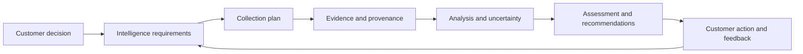

# Customer-Focused Cyber Threat Intelligence: A Practical Learning Guide

Prepared **29 October 2026**. Level: beginner to intermediate. Suggested pace: **8 weeks, 5–7 hours per week**.

**Scope:** This guide interprets “Customer Threat Intelligence” as **Cyber Threat Intelligence (CTI) tailored to a particular customer or organization**. CTI is the established discipline; the customer focus means that collection, analysis, and reporting serve that organization's decisions. The same workflow applies to an internal security team, a consultancy, or a managed security service provider.

You will learn to turn a security report, an indicator, or an incident finding into an assessment that answers: **What does this mean for this customer, how certain are we, and what should happen next?**

The customer, infrastructure, events, and assessments in the exercises are fictional unless explicitly identified as public source material. Exercises use synthetic data and documentation addresses. No malware execution, scanning, paid subscription, or production access is required. Python examples use only the standard library.

## Contents

1. [Understand the discipline](#1-understand-the-discipline)
2. [Build the foundations and follow a learning plan](#2-build-the-foundations-and-follow-a-learning-plan)
3. [Define the customer and intelligence requirements](#3-define-the-customer-and-intelligence-requirements)
4. [Collect information with provenance and handling rules](#4-collect-information-with-provenance-and-handling-rules)
5. [Analyze evidence and communicate uncertainty](#5-analyze-evidence-and-communicate-uncertainty)
6. [Use analytical models and ATT&CK](#6-use-analytical-models-and-attck)
7. [Lab 1: Write customer intelligence requirements](#7-lab-1-write-customer-intelligence-requirements)
8. [Lab 2: Turn a public report into customer advice](#8-lab-2-turn-a-public-report-into-customer-advice)
9. [Lab 3: Match indicators to synthetic telemetry](#9-lab-3-match-indicators-to-synthetic-telemetry)
10. [Lab 4: Prioritize vulnerabilities using customer context](#10-lab-4-prioritize-vulnerabilities-using-customer-context)
11. [Lab 5: Convert intelligence into a detection hypothesis](#11-lab-5-convert-intelligence-into-a-detection-hypothesis)
12. [Lab 6: Represent intelligence with STIX and platforms](#12-lab-6-represent-intelligence-with-stix-and-platforms)
13. [Lab 7: Connect Kubernetes DFIR to CTI](#13-lab-7-connect-kubernetes-dfir-to-cti)
14. [Write intelligence products and measure usefulness](#14-write-intelligence-products-and-measure-usefulness)
15. [Capstone and assessment rubric](#15-capstone-and-assessment-rubric)
16. [Learning resources and reference library](#16-learning-resources-and-reference-library)
17. [Common mistakes and a working checklist](#17-common-mistakes-and-a-working-checklist)

## 1. Understand the discipline

### 1.1 From data to a decision

Consider three different outputs:

| Output | Example | What is still missing? |
|---|---|---|
| Raw data | A proxy recorded a connection to `203.0.113.44`. | Whether the destination or activity is suspicious |
| Contextual information | A source associates that address with a campaign during a particular time window. | Whether that claim is reliable and relevant to this customer's event |
| Intelligence assessment | The event overlaps the reported activity period and came from a finance workstation; investigate the process and identity history before deciding on containment. | Follow-up evidence and the outcome of the decision |

An indicator feed can support CTI, but the feed alone does not answer a customer's intelligence requirement. A useful assessment combines evidence, customer context, reasoning, uncertainty, and a decision or action.

NIST describes threat information broadly, including indicators, adversary behavior, defensive actions, and incident analysis. Its sharing guidance is a useful foundation for deciding what information to exchange and why. Read [NIST SP 800-150: Guide to Cyber Threat Information Sharing](https://csrc.nist.gov/pubs/sp/800/150/final).

### 1.2 Intelligence products and their audiences

These categories are useful working distinctions; organizations sometimes group them differently.

| Type | Typical audience | Question | Useful output |
|---|---|---|---|
| Strategic | Leadership, business risk owners | Which threats could materially affect our objectives? | Short assessment of business exposure and investment options |
| Operational | Incident response, SOC leadership | How is a relevant campaign operating, and what should we prepare for? | Campaign brief with scope, timing, behaviors, and response priorities |
| Tactical | Threat hunters, detection engineers | Which adversary behaviors should we find or disrupt? | ATT&CK mappings, hunt hypotheses, detection requirements |
| Technical | Analysts and security tooling | Which observable values should we search for, and under what conditions? | Indicators with provenance, time bounds, confidence, and handling restrictions |

**Practice:** Explain the same fictional phishing campaign to a chief financial officer, an identity administrator, and a SOC analyst. Change the decision and level of detail for each audience.

### 1.3 Essential vocabulary

| Term | Working meaning |
|---|---|
| Observable | Something recorded or measured, such as a domain, process, file hash, or login |
| Indicator of compromise, IOC | An observable or pattern assessed as useful for identifying potentially malicious activity |
| TTP | Tactic, technique, and procedure: objective, general method, and specific implementation |
| Threat actor | A person or group conducting malicious activity; names and boundaries can differ between reporting organizations |
| Campaign | Related activity grouped by a shared objective or other supported relationships |
| PIR | Priority intelligence requirement: a prioritized question tied to a decision |
| Collection requirement | Specific information needed to help answer a PIR |
| Provenance | Where information came from and how it reached the analyst |
| Confidence | How strongly the available evidence and reasoning support an assessment |
| Likelihood | An assessment of whether an event or outcome will occur or is true |
| Intelligence gap | Information that is missing and could change the assessment |

DFIR asks what happened in a particular case and preserves the evidence. CTI can use those findings to identify relevant behavior, improve collection, and inform other customer decisions. A DFIR finding does not automatically establish a named actor or a wider campaign.

## 2. Build the foundations and follow a learning plan

### 2.1 Prerequisites

You should be able to explain a DNS lookup, an HTTP request, a process tree, authentication versus authorization, and the purpose of common endpoint and identity logs. Practice reading timestamps with time zones, JSON records, and command lines.

For this workspace, useful supporting material includes the [network security guide](GUIDE_Network_Security_Interview.md), [Windows DFIR guide](GUIDE_Windows_DFIR.md), [Linux DFIR guide](GUIDE_Linux_DFIR.md), and [Kubernetes DFIR guide](GUIDE_Kubernetes_DFIR.md).

Start with a text editor, a browser, and Python 3.10 or later. Use a separate practice directory for files you create while following the guide. The Kubernetes exercise reads an existing fixture and needs no cluster.

### 2.2 Eight-week learning plan

The time allocations below are learning estimates, not course-provider requirements. Spend roughly one third of each week reading and two thirds producing or reviewing an artifact.

| Week | Focus and reading | Practice | Completion evidence |
|---|---|---|---|
| 1 | CTI vocabulary; [FIRST CTI curriculum](https://www.first.org/global/sigs/cti/curriculum/); NIST sharing guidance | Define a customer and interview three fictional stakeholders | Customer profile and three PIRs |
| 2 | Collection, source evaluation, provenance, and TLP | Build a collection plan; trace three articles to their original evidence | Source register and evidence ledger |
| 3 | ATT&CK concepts and [MITRE CTI training](https://attack.mitre.org/resources/learn-more-about-attack/training/cti/) | Complete Lab 2 and an official training exercise | Five defensible behavior mappings |
| 4 | Observables, indicator validity, enrichment, and false positives | Complete Lab 3; deliberately introduce stale and misleading matches | Triage notes and documented limitations |
| 5 | Vulnerability intelligence and customer exposure | Complete Lab 4; compare KEV, EPSS, and CVSS | Prioritized work queue with reasons and owners |
| 6 | Detection requirements and structured intelligence | Complete Labs 5 and 6 | Detection hypothesis, test cases, and STIX example |
| 7 | Incident-derived intelligence and cloud/container context | Complete Lab 7 | Evidence-linked Kubernetes assessment |
| 8 | Writing, feedback, and analytical review | Complete the capstone and give a five-minute briefing | Portfolio package and reviewer feedback |

If you already investigate incidents, start with Sections 3–6 and the labs. If security concepts are new, spend an extra week on networking, operating systems, and identity before beginning.

### 2.3 A repeatable analyst workflow



This diagram remains understandable as a sequence if your Markdown viewer does not render Mermaid. For background on the intelligence cycle and analytical techniques, use [FIRST's machine and human analysis module](https://www.first.org/global/sigs/cti/curriculum/machine-human).

## 3. Define the customer and intelligence requirements

### 3.1 Running example: Northstar Retail

Northstar Retail is a fictional European retailer preparing for a seasonal sales peak.

| Dimension | Training assumption |
|---|---|
| Business | Online orders and a customer support operation |
| Geography | Poland and other EU markets |
| Important services | Checkout, identity provider, order fulfillment, support platform |
| Environment | Microsoft 365 and Entra ID, Windows endpoints, Linux services, Kubernetes workloads |
| Important information | Customer contact details, order records, support conversations |
| External dependencies | Payment provider, software suppliers, outsourced help desk |
| Security visibility | Endpoint events, identity sign-ins, email events, proxy/DNS logs, Kubernetes audit logs |
| Known gaps | Uneven log retention; incomplete service ownership; help-desk reset verification needs review |
| Decisions | Protect sales availability, prioritize remediation, improve identity controls, direct threat hunts |

These are assumptions for learning, not findings about your environment. In real work, record who confirmed each item and when. “The customer uses Kubernetes” is too broad: cluster ownership, public exposure, identities, workloads, and business dependencies determine relevance.

### 3.2 Interview the people who will use the intelligence

Ask a business owner which service interruptions matter most and what decision is coming next. Ask the SOC what it can actually observe and investigate. Ask platform and identity owners which controls exist, how they are verified, and where change constraints apply.

Useful interview questions:

1. Which business outcome must we protect over the next 30–90 days?
2. Which decision could better threat information change?
3. Which systems, accounts, suppliers, and regions are in scope?
4. What evidence can we obtain, and how far back does it go?
5. Who can act on the answer, and by when?
6. What would make the current assessment wrong?

### 3.3 Write questions that lead to decisions

| Weak request | Better PIR | Decision owner |
|---|---|---|
| “Monitor ransomware.” | Which reported intrusion methods are relevant to Northstar's exposed services and identity workflows before the sales peak? | Security operations lead |
| “Tell us about vulnerabilities.” | Which confirmed affected assets have evidence of exploitation in the wild and a plausible path to checkout disruption? | Vulnerability and service owners |
| “Track cloud threats.” | Which abuses of Kubernetes API permissions could access order data, and can our current telemetry identify them? | Platform security lead |

Each PIR should have a scope, deadline, consumer, collection plan, and review trigger. Keep the list small enough to answer. FIRST's [PIR module](https://www.first.org/global/sigs/cti/curriculum/pir) explains why requirements need to remain tied to changing operational decisions.

Use this original practice template:

```text
PIR ID: PIR-01
Question: Which identity abuse methods should Northstar prioritize this month?
Decision: Select two identity-control improvements and one SOC hunt.
Consumer / owner: Identity lead / CTI analyst.
Scope: Workforce identities, help-desk resets, privileged access.
Time horizon: Next 30 days; review weekly and after a relevant incident.
Required information:
  - Relevant reported behaviors and their original evidence.
  - Northstar's reset procedures and authentication controls.
  - Available sign-in, reset, and privilege-change telemetry.
Deliverable: One-page assessment plus hunt requirements.
Completion criteria: Owner can select an action and understands evidence gaps.
```

## 4. Collect information with provenance and handling rules

### 4.1 Build a collection plan

Collect because a source can answer a question. A large feed collection creates work unless you can explain its relevance.

| Information need | Preferred source | What to record | Important limitation |
|---|---|---|---|
| Actual customer behavior | Customer logs, incident records, control tests | Scope, retention, event time, collection method | Missing or incomplete telemetry can hide activity |
| Affected product versions | Vendor advisory and verified inventory | Product, version, configuration, advisory revision | A matching product name does not prove applicability |
| Known exploitation | CISA KEV and original incident/advisory reporting | CVE, source date, supporting reference | Does not establish compromise of this customer |
| Adversary behavior | Primary incident reports, CERT reports, ATT&CK references | Exact supporting passage and mapping rationale | Visibility and reporting bias affect coverage |
| Indicator context | Original report, approved enrichment tools, internal sightings | First/last observed, provenance, role, expiry | Shared or reassigned infrastructure causes ambiguity |
| Regional relevance | CERT Polska or another relevant national/sector team | Reporting period, affected population, methodology | National statistics do not measure one customer's exposure |

Start with [CERT Polska publications](https://cert.pl/publikacje/), [MITRE ATT&CK resources](https://attack.mitre.org/resources/), vendor advisories for the actual technology inventory, and the customer's own evidence.

### 4.2 Maintain an evidence ledger

Use one row or record per claim rather than one undifferentiated note per article.

```text
Evidence ID: E-014
Claim: A help-desk reset was followed by a sign-in from an unfamiliar device.
Source: Fictional customer identity export, event IDs reset-48 and login-92.
Event time: 2026-10-20T09:14:00Z and 2026-10-20T09:19:00Z.
Collected at: 2026-10-20T10:05:00Z.
Source type: Internal telemetry; export method recorded separately.
Independence: Separate event types from the same identity service.
Limitations: Device unfamiliarity alone does not establish an attacker.
Handling: Customer-restricted; retain according to the case's approved policy.
Supports: Investigation of reset-to-login sequence.
Does not establish: Identity theft, data theft, or attribution to a named actor.
```

Keep **event time**, **publication time**, **collection time**, and **assessment time** separate. A newly published report may describe old activity. Repeated publication does not make an old indicator current.

For downloaded public data, preserve the source URL, retrieval time in UTC, any publisher version/date, and a SHA-256 digest of the original bytes. Store your derived notes separately. A hash detects later changes to your copy; it does not prove the publisher's claims are true.

### 4.3 Evaluate sources and claims separately

A source's track record and a particular claim's evidentiary support are different questions. FIRST describes separate source and information reliability ratings in its [source evaluation module](https://www.first.org/global/sigs/cti/curriculum/source-evaluation).

For every important claim, ask:

- Does the author have direct visibility, or repeat another report?
- Can you find the original evidence and its collection context?
- Do corroborating sources provide independent observations?
- Does the date, platform, geography, or customer population match the question?
- Is contradictory evidence available?

**Exercise:** Three news articles and two vendor summaries cite the same incident report. Record one originating evidence chain. Five publications do not provide five independent confirmations.

### 4.4 Sharing and customer boundaries

Use the source's handling restrictions when preparing a deliverable. A short summary of [FIRST TLP 2.0](https://www.first.org/tlp/):

| Marking | Sharing boundary |
|---|---|
| `TLP:RED` | Individual recipients only |
| `TLP:AMBER+STRICT` | Recipient's organization, on a need-to-know basis |
| `TLP:AMBER` | Recipient's organization and clients who need the information to protect themselves |
| `TLP:GREEN` | Relevant community; no public channels |
| `TLP:CLEAR` | No TLP restriction; other applicable rights still matter |

Additional source restrictions still apply. TLP communicates sharing boundaries; it does not replace access controls or create permission to disclose customer data. In a consultancy or MSSP, preserve tenant separation and remove identifying details before reusing an approved analytical lesson.

Do not upload customer evidence to a public enrichment service simply because it accepts files or URLs. VirusTotal explains that submissions contribute to shared analysis. Start with approved lookups and understand the service's visibility and terms. Even a lookup can disclose what you are investigating. See [VirusTotal: How it works](https://docs.virustotal.com/docs/how-it-works).

## 5. Analyze evidence and communicate uncertainty

### 5.1 Separate observations, assessments, and assumptions

| Category | Fictional example |
|---|---|
| Observation | A logged password reset preceded a successful sign-in by five minutes. |
| Assessment | The sequence merits investigation for possible account takeover. |
| Assumption | The exported events are complete for the relevant period. |
| Gap | We have not obtained the reset approval record. |
| Recommendation | Identity operations should correlate the reset ticket, device history, and session activity. |

Write an observation so another analyst can locate the evidence. Write an assessment so they can follow the reasoning. State assumptions explicitly, especially when they are carrying an otherwise weak conclusion.

### 5.2 Compare alternative explanations

Suppose a finance workstation contacts an address mentioned in a threat report.

| Hypothesis | Evidence that would support it | Evidence that would weaken it |
|---|---|---|
| Malicious activity | Matching time window, suspicious initiating process, related identity or file events | A documented benign application explains the complete sequence |
| Shared infrastructure | The destination serves unrelated legitimate tenants | Dedicated attacker infrastructure is independently established for that period |
| Authorized security activity | Matching approved test plan, operator, and timing | No matching test and inconsistent execution details |
| Stale association | Source association ended before the event; ownership changed | Contemporaneous evidence confirms the malicious role |

Choose the next collection step that best distinguishes these explanations. A process tree may be more useful than querying five additional reputation services that repeat the same feed.

This is a lightweight competing-hypotheses exercise. Do not assign arbitrary points and present the total as a calibrated probability. Explain why particular evidence is diagnostic and which assumptions remain.

### 5.3 Confidence is not likelihood

An event can be assessed as likely with low confidence if the evidence is weak. Conversely, good evidence may support high confidence that an outcome is unlikely. Establish a shared vocabulary with the reader. FIRST provides guidance on [communicating uncertainties in CTI reporting](https://www.first.org/global/sigs/cti/curriculum/cti-reporting).

For these exercises, use this qualitative convention:

| Confidence | Practice criterion |
|---|---|
| High | Strong relevant evidence, meaningful corroboration, and few material gaps |
| Moderate | Credible support, but important gaps or alternatives remain |
| Low | Limited, indirect, conflicting, or poorly contextualized evidence |

Attach confidence to a **specific judgment**. Do not assign one confidence label to every claim in a long report.

Example: “We assess with moderate confidence that the reset workflow deserves immediate review because the observed sequence is consistent with misuse and approval evidence is missing. Authorized user recovery remains a plausible explanation.”

### 5.4 Avoid unsupported attribution

Shared tools, IP addresses, languages, working hours, or technique IDs rarely identify an actor by themselves. Preserve each source's naming and stated confidence. Two vendors may use overlapping but different actor clusters.

For most customer decisions, “an identity abuse pattern relevant to our reset process” is sufficient to justify review. If naming an actor does not change the decision, prioritize the behavior and evidence.

## 6. Use analytical models and ATT&CK

### 6.1 Select a model for a question

| Model or representation | Use it to answer | Limitation |
|---|---|---|
| Intelligence cycle | What should we collect, analyze, deliver, and revise? | It requires an actual customer question |
| MITRE ATT&CK | Which adversary behaviors are supported by the evidence? | A technique list is not an ordered incident timeline or a risk score |
| Diamond Model | How do adversary, capability, infrastructure, and victim relate in an event? | Missing features should remain unknown |
| Attack Flow | How do supported actions and decisions connect through an attack? | Inferred sequence must be distinguished from observed sequence |
| STIX / TAXII | How can we represent and exchange structured threat information? | Structure and transport do not validate analytical truth |

Read the [original Diamond Model paper](https://www.activeresponse.org/wp-content/uploads/2013/07/diamond.pdf) for its four core features and event-linking approach. Explore [Attack Flow's overview and examples](https://center-for-threat-informed-defense.github.io/attack-flow/overview/) when a flat technique list loses the sequence.

### 6.2 Map behavior, not keywords

Use the narrowest ATT&CK technique that the evidence supports. Preserve the supporting passage or event, your rationale, and the ATT&CK version or access date.

| Synthetic observation | Candidate mapping | What must be established? |
|---|---|---|
| A targeted email contained a link intended to induce a user to visit attacker-controlled content. | [T1566.002: Spearphishing Link](https://attack.mitre.org/techniques/T1566/002/) | Delivery context and malicious purpose; a URL alone is insufficient |
| An adversary executed commands through PowerShell. | [T1059.001: PowerShell](https://attack.mitre.org/techniques/T1059/001/) | Evidence of interpreter execution in the malicious sequence |
| An adversary used an existing account to access a service. | [T1078: Valid Accounts](https://attack.mitre.org/techniques/T1078/) | Account abuse; successful authentication alone is ordinary behavior |
| An adversary used a container administration interface to run a command. | [T1609: Container Administration Command](https://attack.mitre.org/techniques/T1609/) | The administration mechanism and relevant execution context |
| A recurring orchestration job was created to continue adversary activity. | [T1053.007: Container Orchestration Job](https://attack.mitre.org/techniques/T1053/007/) | Job creation and purpose; ordinary scheduled work is common |

The table is an analyst-created illustration, not an assertion about a real campaign.

### 6.3 Turn a mapping into a defensive question

For each selected technique, identify:

1. The customer asset or workflow where the behavior matters.
2. The telemetry and fields needed to observe it.
3. A hunt or detection hypothesis.
4. Plausible benign explanations and collection gaps.
5. A mitigation or investigation action with an owner.

Keep threat relevance, telemetry availability, analytic implementation, and successful validation as separate fields. Coloring a technique in [ATT&CK Navigator](https://github.com/mitre-attack/attack-navigator) does not establish detection coverage.

MITRE's [CTI training](https://attack.mitre.org/resources/learn-more-about-attack/training/cti/) includes videos, exercises, and answers. Its original exercises use an older ATT&CK version; follow MITRE's version guidance when comparing your answers with the supplied solutions.

## 7. Lab 1: Write customer intelligence requirements

**Time:** 45–60 minutes. **Inputs:** Northstar's fictional profile. **Output:** `customer-profile.md`, `requirements.md`, and `collection-plan.md` in your practice directory.

1. Pick three consumers: a business owner, an identity lead, and a SOC lead.
2. Write the decision each consumer needs to make in the next month.
3. Create one PIR per decision using the template in Section 3.
4. For each PIR, identify two external sources and two internal evidence sources.
5. Record missing information, expected collection effort, and a review date.
6. Ask a peer to act as the customer and remove requests that cannot change a decision.

**Worked example:** A report about help-desk social engineering is relevant because Northstar uses an outsourced reset workflow. The immediate information need is whether resets require an independently verified approval and whether reset events can be joined to later sessions. The resulting action could be a workflow change and a targeted hunt. A list of actor aliases would not answer that need.

**Completion check:** Every PIR names a consumer, decision, scope, time horizon, and evidence requirement. At least one collection gap has a named owner. “Monitor everything” is not accepted as a requirement.

## 8. Lab 2: Turn a public report into customer advice

**Time:** 60–90 minutes. **Output:** an evidence table, ATT&CK mappings, and a one-page brief.

Choose one primary source:

- The joint [Scattered Spider advisory, AA23-320A](https://www.cisa.gov/news-events/cybersecurity-advisories/aa23-320a), or its [2025 revised PDF](https://www.cisa.gov/sites/default/files/2025-08/aa23-320a-scattered-spider-508c.pdf).
- One of the source reports packaged with [MITRE's CTI training exercises](https://attack.mitre.org/resources/learn-more-about-attack/training/cti/).
- A suitable technical case in [CERT Polska's 2025 annual report](https://cert.pl/en/posts/2026/04/annual-report-2025/).

These are historical learning sources, not proof of a current campaign against Northstar. Record the report's publication and revision dates and distinguish those from the incident dates. CISA pages can restrict automated retrieval; use the alternatives if access fails.

### Procedure

1. Read once for the narrative and once for observable behaviors.
2. Extract five supported behavior statements, with page or section references.
3. Mark each as directly observed, source-assessed, or unclear in the report.
4. Map the supported statements to ATT&CK; leave uncertain mappings unresolved.
5. Compare the behaviors with Northstar's systems and workflows.
6. Select two actions the customer can take and identify the required telemetry.
7. State one alternative explanation and two intelligence gaps.
8. Write a 150–250-word customer summary.

Use this table:

| Evidence ID and location | Source behavior | ATT&CK candidate and rationale | Customer relevance | Evidence needed locally | Owner/action |
|---|---|---|---|---|---|
| E-01, section/page | Your concise paraphrase | ID plus why the described behavior fits | Specific system or workflow | Log source, fields, and time range | Who does what |

### Example of the reasoning, using an invented source statement

**Training statement:** “The operator emailed a link to a counterfeit sign-in page to selected finance staff.”

- **Mapping:** T1566.002, because the statement explicitly describes targeted email delivery of a malicious link.
- **Customer relevance:** Northstar has finance users and a workforce identity service.
- **Collection:** Email message and URL events, user interaction evidence, identity sign-ins, session and device context.
- **Gap:** The statement does not establish that a user submitted a password or that a session was stolen.
- **Action:** Have email and identity teams assess the delivery path and inspect any corresponding local sequence.

**Completion check:** A reader can trace every mapping to evidence and every recommendation to a customer requirement. Avoid copying a report's actor name into your own conclusion without preserving its attribution caveats.

## 9. Lab 3: Match indicators to synthetic telemetry

**Time:** 45–60 minutes. **Prerequisite:** Python 3.10+. **Output:** triage results and a short assessment. This exercise is completely offline.

### 9.1 Record an indicator's context

A useful indicator record includes its type and value, originating source, assessed role, confidence and rationale, observation dates, local validity window, scope, and action policy. Keep an actual sighting separate from the indicator definition.

The `valid_from` and `valid_until` values below are **invented exercise policy**, not a universal lifetime for domains or IP addresses. Domain suffix matching is explicitly enabled for the two example domains; do not silently assume that all subdomains inherit every threat association.

Save this as `ioc_triage.py` in your practice directory:

```python
from collections import Counter
from datetime import datetime
from ipaddress import ip_address


def timestamp(value):
    return datetime.fromisoformat(value.replace("Z", "+00:00"))


def domain(value):
    # This lab accepts hostnames, not arbitrary URLs or wildcard patterns.
    return value.strip().rstrip(".").encode("idna").decode("ascii").lower()


def matches(event, indicator):
    if event["type"] != indicator["type"]:
        return False
    if event["type"] == "ip":
        return ip_address(event["value"]) == ip_address(indicator["value"])
    host, base = domain(event["value"]), domain(indicator["value"])
    return host == base or (
        indicator.get("include_subdomains", False)
        and host.endswith("." + base)
    )


indicators = [
    {"id": "IOC-01", "type": "domain", "value": "shop-alert.example",
     "include_subdomains": True, "source": "fictional-report-A",
     "valid_from": "2026-10-01T00:00:00Z",
     "valid_until": "2026-10-31T00:00:00Z"},
    {"id": "IOC-02", "type": "ip", "value": "203.0.113.44",
     "source": "fictional-report-B",
     "valid_from": "2026-10-01T00:00:00Z",
     "valid_until": "2026-10-31T00:00:00Z"},
    {"id": "IOC-03", "type": "domain", "value": "legacy-c2.example",
     "include_subdomains": True, "source": "fictional-report-C",
     "valid_from": "2026-09-01T00:00:00Z",
     "valid_until": "2026-10-01T00:00:00Z"},
]

events = [
    {"id": "EV-01", "asset": "finance-01", "type": "domain",
     "value": "Login.shop-alert.example.", "time": "2026-10-20T09:00:00Z"},
    {"id": "EV-02", "asset": "web-01", "type": "ip",
     "value": "203.0.113.44", "time": "2026-10-20T09:01:00Z"},
    {"id": "EV-03", "asset": "finance-02", "type": "domain",
     "value": "api.legacy-c2.example", "time": "2026-10-20T09:02:00Z"},
    {"id": "EV-04", "asset": "finance-03", "type": "domain",
     "value": "shop-alert.example.evil.example", "time": "2026-10-20T09:03:00Z"},
    {"id": "EV-05", "asset": "finance-04", "type": "domain",
     "value": "cdn.example", "time": "2026-10-20T09:04:00Z"},
]

counts = Counter()
for event in events:
    candidates = [ioc for ioc in indicators if matches(event, ioc)]
    if not candidates:
        counts["NO_MATCH"] += 1
        print(event["id"], event["asset"], "NO_MATCH")
        continue
    for ioc in candidates:
        when = timestamp(event["time"])
        in_window = timestamp(ioc["valid_from"]) <= when < timestamp(ioc["valid_until"])
        status = "REVIEW" if in_window else "OUTSIDE_VALIDITY"
        counts[status] += 1
        print(event["id"], event["asset"], ioc["id"], status)

print("Summary:", dict(sorted(counts.items())))
```

Run:

```bash
python3 ioc_triage.py
```

Expected output:

```text
EV-01 finance-01 IOC-01 REVIEW
EV-02 web-01 IOC-02 REVIEW
EV-03 finance-02 IOC-03 OUTSIDE_VALIDITY
EV-04 finance-03 NO_MATCH
EV-05 finance-04 NO_MATCH
Summary: {'NO_MATCH': 2, 'OUTSIDE_VALIDITY': 1, 'REVIEW': 2}
```

### 9.2 Interpret the result

`REVIEW` means a value matched within the exercise's validity window. It does not establish malware execution, attacker control, or customer compromise. `NO_MATCH` does not establish that an event is benign. `OUTSIDE_VALIDITY` requires context review and may still justify retrospective investigation.

The domain matcher respects label boundaries: `shop-alert.example.evil.example` does not match `shop-alert.example`. It also handles case and the DNS trailing dot. This small example is not a production parser: add validation, malformed-record handling, and separate URL/port/CIDR semantics before adapting it to other data types.

The window check uses **event time**. Before taking action today, separately reassess whether the indicator is still relevant today. If several indicators match one event, the script counts each match; deduplicate by event ID when reporting unique affected events or assets.

### 9.3 Questions and extensions

1. What process, user, or workload generated EV-01 and EV-02?
2. Is IOC-02 dedicated infrastructure or a shared service?
3. What evidence could explain EV-03 without malicious activity?
4. Change EV-01 to occur exactly at `valid_until`. It should become `OUTSIDE_VALIDITY` because the upper bound is exclusive.
5. Disable subdomain matching for IOC-01. EV-01 should become `NO_MATCH`.
6. Draft a conclusion that preserves uncertainty and requests the next useful evidence.

**Completion check:** Explain all five outputs and identify a follow-up collection step for each match. Do not query the fictional domains or documentation IP in external services.

## 10. Lab 4: Prioritize vulnerabilities using customer context

**Time:** 45–75 minutes. **Output:** a reasoned queue with asset owners. The core exercise is offline; a live-data extension is optional.

### 10.1 Keep three signals distinct

| Signal | What it contributes | What it does not establish |
|---|---|---|
| CVSS | Standardized vulnerability severity characteristics; metric groups add threat and environmental context | A CVSS Base score alone is not the customer's risk or exploitation probability |
| EPSS | Model-estimated probability that a published CVE will be exploited in the wild in the next 30 days | Probability that this particular customer will be compromised |
| KEV | Catalog evidence of exploitation in the wild | Whether a particular asset is affected or has been exploited |

Use the [FIRST CVSS specification](https://www.first.org/cvss/v4.0/specification-document), [FIRST EPSS overview](https://www.first.org/epss/), and [CISA's official KEV data repository](https://github.com/cisagov/kev-data) for the definitions and data. An EPSS percentile is a ranking, not the same value as the estimated probability.

Join these signals to verified applicability, exposure paths, business impact, control evidence, and service ownership. Absence from KEV is not evidence of no exploitation. Missing EPSS data is not a zero score. Source outages should produce a collection error, not a finding that no vulnerabilities are known to be exploited.

### 10.2 Apply an explicit exercise policy

For this lab, use the following **local training policy**, not an industry SLA or a quantitative risk model:

1. Evidence of compromise: route to incident response immediately.
2. Unknown applicability: verify it promptly with an owner; escalate the uncertainty if exposure or impact warrants it.
3. Confirmed affected, internet exposed, and in KEV: urgent remediation coordination.
4. Confirmed affected and in KEV with no direct internet exposure: expedited remediation and review of reachable attack paths.
5. Confirmed unaffected: record the evidence and reassessment trigger.
6. Other affected assets: contextual review using impact, exposure, advisories, EPSS, and controls.

Save as `prioritize.py`:

```python
import json
import sys
from pathlib import Path

# Minimal fictional fixture using real historical CVE identifiers.
# This is NOT a complete or dated snapshot of the CISA catalog.
catalog = {
    "catalogVersion": "TRAINING-FIXTURE",
    "vulnerabilities": [
        {"cveID": "CVE-2021-44228"},
        {"cveID": "CVE-2023-34362"},
    ],
}

# Optional: supply a downloaded official KEV JSON file.
if len(sys.argv) > 2:
    raise SystemExit("Usage: python3 prioritize.py [kev.json]")
if len(sys.argv) == 2:
    catalog = json.loads(Path(sys.argv[1]).read_text(encoding="utf-8"))
if not isinstance(catalog, dict) or not isinstance(catalog.get("vulnerabilities"), list):
    raise SystemExit("Invalid catalog: expected a vulnerabilities list")
rows = catalog["vulnerabilities"]
if not rows or any(not isinstance(row, dict) or not row.get("cveID") for row in rows):
    raise SystemExit("Invalid or empty catalog: do not treat as no KEV matches")
kev = {row["cveID"] for row in rows}

assets = [
    {"name": "transfer-edge", "cve": "CVE-2023-34362", "affected": True,
     "internet": True, "compromise_evidence": False, "owner": "File-transfer team"},
    {"name": "orders-java", "cve": "CVE-2021-44228", "affected": True,
     "internet": False, "compromise_evidence": False, "owner": "Orders team"},
    {"name": "verified-fixed", "cve": "CVE-2021-44228", "affected": False,
     "internet": True, "compromise_evidence": False, "owner": "Platform team"},
    {"name": "inventory-gap", "cve": "CVE-2021-44228", "affected": None,
     "internet": True, "compromise_evidence": False, "owner": "Asset owner"},
    {"name": "identity-case", "cve": None, "affected": None,
     "internet": True, "compromise_evidence": True, "owner": "Incident response"},
]


def prioritize(asset):
    if asset["compromise_evidence"]:
        return "IR-NOW", "investigate observed compromise evidence"
    if asset["affected"] is None:
        return "VERIFY", "applicability unknown; assign verification"
    if asset["affected"] is False:
        return "N/A", "confirmed unaffected; retain verification evidence"
    if asset["cve"] in kev and asset["internet"]:
        return "P1", "affected, internet exposed, KEV listed"
    if asset["cve"] in kev:
        return "P2", "affected and KEV listed; assess internal reachability"
    return "REVIEW", "affected; assess other exploitation and impact evidence"


print("Catalog:", catalog.get("catalogVersion", "unspecified"))
for asset in assets:
    priority, reason = prioritize(asset)
    print(f"{asset['name']}: {priority} | {reason} | owner={asset['owner']}")
```

Run `python3 prioritize.py`. Expected classifications, in input order:

```text
transfer-edge: P1
orders-java: P2
verified-fixed: N/A
inventory-gap: VERIFY
identity-case: IR-NOW
```

The actual output also includes the reason and owner. The fictional applicability flags represent prior verification; the script does not discover installed versions or scan assets. The identity case illustrates why incident evidence takes precedence over a CVE-only workflow.

### 10.3 Optional: replace the fixture with public data

Download JSON from the [CISA KEV catalog](https://www.cisa.gov/known-exploited-vulnerabilities-catalog) or the [JSON file in CISA's official mirror](https://github.com/cisagov/kev-data/blob/develop/known_exploited_vulnerabilities.json). Save the raw JSON as `kev.json`, not the GitHub HTML page, and record its retrieval time and publisher metadata.

Then run:

```bash
python3 prioritize.py kev.json
```

For a small EPSS lookup, see [FIRST's data access documentation](https://www.first.org/epss/data.html). If `curl` is available, this request retrieves public information about a historical CVE:

```bash
curl --fail --show-error --silent --location --max-time 30 \
  'https://api.first.org/data/v1/epss?cve=CVE-2021-44228'
```

Record the returned score date, probability, and percentile. Live values change, so there is no fixed expected score. Consult the provider's current bulk-download guidance for larger datasets rather than repeating single-record requests.

**Completion check:** Justify why an internal affected service still matters, why an unknown version needs verification, and why high-severity findings cannot be ranked responsibly without customer context. Do not copy a feed's due date into a customer deadline without establishing the applicable requirement and agreed remediation process.

## 11. Lab 5: Convert intelligence into a detection hypothesis

**Time:** 45–60 minutes. **Output:** a draft analytic, test cases, and an investigation runbook.

### 11.1 Write the hypothesis first

**Fictional intelligence input:** A relevant intrusion report describes PowerShell execution with an encoded command argument.

**Hypothesis:** On Northstar Windows endpoints, process creation events containing PowerShell with an encoded command argument can identify activity worth reviewing, especially when correlated with unexpected parent processes or recent suspicious identity activity.

**Telemetry requirement:** Process creation data containing executable path, complete command line, timestamp, endpoint identity, user, and preferably parent-process details. Verify which source and configuration actually provide those fields.

**Known limit:** Administrative automation can generate the same behavior. This is a narrow signal supporting a hunt, not proof of maliciousness or complete coverage of T1059.001.

### 11.2 Draft a Sigma rule

The following is an original educational rule. Save as `powershell_encoded_training.yml` if you want to work with a Sigma toolchain:

```yaml
title: PowerShell Encoded Command Argument - Training Example
id: f70aa960-6ae7-4d1a-a861-89e5670c6a7a
status: experimental
description: Narrow hunt signal; review command context and approved automation.
author: CTI Learning Lab
date: 2026-10-29
tags:
  - attack.execution
  - attack.t1059.001
logsource:
  category: process_creation
  product: windows
detection:
  selection_image:
    Image|endswith:
      - '\powershell.exe'
      - '\pwsh.exe'
  selection_argument:
    CommandLine|contains:
      - ' -enc '
      - ' -encodedcommand '
  condition: selection_image and selection_argument
falsepositives:
  - Approved administrative automation using encoded command arguments
level: medium
```

Read the official [Sigma rule documentation](https://sigmahq.io/docs/basics/rules.html) and [Sigma specification](https://github.com/SigmaHQ/sigma-specification). A Sigma backend and processing pipeline must map the rule to your SIEM's event schema. Conversion alone does not establish correct collection or detection behavior.

### 11.3 Test with event records, without executing commands

These command lines are **sample log strings**. `TRAINING_PLACEHOLDER` is not a payload to run.

| Synthetic event | Expected result | Reason |
|---|---|---|
| Image ends in `\powershell.exe`; command line contains ` -EncodedCommand TRAINING_PLACEHOLDER` | Match under standard case-insensitive Sigma string semantics | Both selections match |
| Image ends in `\pwsh.exe`; command line contains ` -enc TRAINING_PLACEHOLDER` | Match | Both selections match |
| Image ends in `\powershell.exe`; command line is `powershell.exe -File inventory.ps1` | No match | No selected encoded-command argument |
| Image ends in `\cmd.exe`; command line contains the text ` -enc ` | No match | Image selection fails |
| Approved automation produces the first event | Match, then benign disposition after investigation | Context changes the disposition, not the raw match |

This narrow rule misses other accepted parameter abbreviations, spacing forms, renamed binaries, and execution without these arguments. Test those gaps deliberately. Missing or truncated command lines also create blind spots.

In a customer-controlled test system, replay representative events through the selected backend and inspect the resulting alerts. Record the backend, mapping pipeline, versions, event source, and results. Until that is done, label the analytic **draft**, not deployed or validated coverage.

### 11.4 Define the response to a match

Record the initiating user, parent process, decoded content if safely obtainable, related files and network activity, and any approved change or automation record. Escalate based on the complete sequence and customer procedure. Keep narrow, reviewed exceptions with owners and expiry dates; a broad exception for all administrator activity would remove valuable visibility.

**Completion check:** Your handoff includes a hypothesis, required fields, positive and negative examples, benign explanations, limitations, investigation steps, and a validation owner.

## 12. Lab 6: Represent intelligence with STIX and platforms

**Time:** 45–60 minutes. **Output:** a structured indicator and a proposed relationship model.

### 12.1 Learn the separation of responsibilities

**STIX** represents structured threat information. **TAXII** provides an application protocol for exchanging it. Neither makes an assertion correct or authorizes sharing. Start with the [OASIS introductory documentation](https://oasis-open.github.io/cti-documentation/), then consult the [STIX 2.1 standard](https://docs.oasis-open.org/cti/stix/v2.1/os/stix-v2.1-os.html) and [TAXII 2.1 standard](https://docs.oasis-open.org/cti/taxii/v2.1/os/taxii-v2.1-os.html).

Keep an observable value, an indicator pattern, observed activity, and a report's assessment conceptually separate. A relationship to a named actor is an analytical assertion that needs evidence.

### 12.2 Inspect a minimal educational indicator

Save as `training_indicator.json`:

```json
{
  "type": "indicator",
  "spec_version": "2.1",
  "id": "indicator--b8d7e10c-e72c-4f79-9c64-706f6b9fe2f7",
  "created": "2026-10-20T10:00:00.000Z",
  "modified": "2026-10-20T10:00:00.000Z",
  "name": "Synthetic domain indicator for an offline exercise",
  "description": "Fictional training data; no assertion about real infrastructure. Do not operationalize.",
  "indicator_types": ["malicious-activity"],
  "pattern_type": "stix",
  "pattern_version": "2.1",
  "pattern": "[domain-name:value = 'shop-alert.example']",
  "valid_from": "2026-10-20T00:00:00Z",
  "valid_until": "2026-10-31T00:00:00Z",
  "labels": ["synthetic-training"]
}
```

Check JSON syntax with:

```bash
python3 -m json.tool training_indicator.json
```

This checks JSON parsing only. It does not validate the STIX schema, pattern semantics, trustworthiness, sharing policy, or fitness for a security control. The exact-match STIX pattern also differs from the explicitly enabled subdomain matching in Lab 3.

For a real exchange, define the producer identity, external references, applicable markings, confidence rationale, and object relationships. Use a STIX-aware validator and the receiver's interoperability checks. Do not invent a standardized marking ID for a handling policy you have not implemented.

### 12.3 Optional platform exercise

| Tool | Useful learning focus | Official material |
|---|---|---|
| MISP | Events, attributes, objects, sightings, taxonomies, warning lists, and controlled sharing | [Documentation](https://www.misp-project.org/documentation/) and [training materials](https://github.com/MISP/misp-training) |
| OpenCTI | Reports, entities, relationships, provenance, and investigation context | [OpenCTI documentation](https://docs.opencti.io/latest/) |
| ATT&CK Navigator | Annotating and comparing supported technique selections | [Project documentation](https://github.com/mitre-attack/attack-navigator) |

Use an isolated practice instance if one is already available, or first draw the object model in a document. Deployment is optional and should follow the platform's current instructions; it is not needed for the core learning path.

Create a fictional report with two observables and one supported behavior. Record the source for every relationship. Inspect whether its export preserves the required provenance and handling information. Demonstrate updating or retiring a stale indicator. A large imported graph is not a substitute for a supported assessment.

**Completion check:** Explain the difference between a domain object, an indicator pattern, a recorded sighting, a report, and an assertion connecting activity to an actor.

## 13. Lab 7: Connect Kubernetes DFIR to CTI

**Time:** 60–90 minutes. **Inputs:** the existing [Kubernetes DFIR lab](k8s-dfir-lab/README.md) and its synthetic audit fixture. **Output:** an evidence-linked assessment and two defensive requirements.

### 13.1 Read the existing scenario accurately

The lab begins with simulated post-compromise actions. An administrator deliberately impersonates the training service account. The scenario does **not** steal a token, exploit an application, or escape a container. Review its [walkthrough](k8s-dfir-lab/LAB_GUIDE.md) and [answers](k8s-dfir-lab/ANSWERS.md).

Your CTI question is:

> Which demonstrated uses of Kubernetes API permissions matter to Northstar's order-processing workloads, and what evidence would distinguish unauthorized use from administration?

The authenticated identity and impersonated identity have different roles. Preserve both. See the official [Kubernetes user impersonation documentation](https://kubernetes.io/docs/reference/access-authn-authz/authentication/#user-impersonation).

### 13.2 Extract a small evidence table offline

Run the following from the **workspace root**, the directory containing `DFIR/`. It reads only the bundled synthetic fixture and prints a derived view:

```bash
python3 - <<'PY'
import json
from pathlib import Path

fixture = Path("DFIR/k8s-dfir-lab/fixtures/audit.sample.jsonl")
events = [json.loads(line) for line in fixture.read_text().splitlines() if line.strip()]
rank = {"RequestReceived": 0, "ResponseStarted": 1, "ResponseComplete": 2, "Panic": 3}
requests = {}
for event in events:
    key = event["auditID"]
    previous = requests.get(key)
    if previous is None or rank.get(event["stage"], -1) > rank.get(previous["stage"], -1):
        requests[key] = event

for event in sorted(requests.values(), key=lambda item: item["requestReceivedTimestamp"]):
    obj = event.get("objectRef", {})
    actor = event.get("user", {}).get("username", "unknown")
    effective = event.get("impersonatedUser", {}).get("username", actor)
    resource = obj.get("resource", "")
    if obj.get("subresource"):
        resource += "/" + obj["subresource"]
    print(" | ".join(map(str, [
        event["requestReceivedTimestamp"], event["auditID"],
        actor, effective, event["verb"], resource,
        event.get("responseStatus", {}).get("code", "unknown"),
    ])))

print(f"Records: {len(events)}; distinct requests: {len(requests)}")
PY
```

Expected summary: **8 records; 7 distinct requests**. One exec request has two stages sharing the same audit ID. The printed authenticated identity is `minikube-user`; five distinct requests use the impersonated training account. Another exec request is collection activity under the administrator identity.

This is a compact fixture exercise. For broader timeline handling, use the existing lab's documented timeline command. Do not assume the toy stage-selection logic handles every real-world audit stream, missing field, or logging failure.

### 13.3 Build an evidence-to-intelligence table

| Fixture finding | Supported interpretation | CTI/defensive use | Unsupported leap to avoid |
|---|---|---|---|
| Successful read of the training Secret under impersonation | The request exercised that effective identity's read permission | Review sensitive-resource access and permission scope | A stolen token or actual customer-data theft |
| Patch of `app-settings` | Configuration was changed by the recorded request | Identify unauthorized configuration-change paths | A particular malware family performed the change |
| `pods/exec` request with switching-protocols status | A streaming exec request was accepted | Investigate container administration; candidate T1609 in the simulated adversary sequence | A complete transcript of later shell activity |
| Creation of `maintenance-heartbeat` CronJob | A recurring orchestration object was created | Candidate T1053.007 in this simulated persistence scenario | Execution success or malicious intent from object creation alone |
| Node-list request returned 403 | That request was denied | Assess an attempted access path and the observed authorization boundary | Successful cluster discovery or proof that all boundaries are secure |

The mappings refer to [T1609](https://attack.mitre.org/techniques/T1609/) and [T1053.007](https://attack.mitre.org/techniques/T1053/007/). Verify behavior and purpose before applying the same mappings to unrelated customer events.

### 13.4 Produce customer actions

Draft two requirements:

1. **Detection:** Identify unexpected effective identities opening exec sessions or creating CronJobs in sensitive namespaces. Require cluster identity, audit ID, both identity fields, namespace/resource, stage/status, and time. Compare with approved automation and responder actions.
2. **Prevention and validation:** Review service-account permissions against the intended workload function. Have the platform owner verify whether unnecessary sensitive-resource reads, exec access, or job creation can be removed and then test the expected workflow.

State the visibility gaps: audit data may not include every command, Secret content, workload runtime effect, or network destination. Pair audit evidence with workload and network telemetry where the question requires it.

**Completion check:** You can explain the distinction between an authenticated administrator and an impersonated service account, count requests without double-counting stages, distinguish collection activity, and avoid claiming a real compromise from the synthetic fixture.

## 14. Write intelligence products and measure usefulness

### 14.1 Use a repeatable customer brief

Copy and adapt this template:

```text
Title: [Decision-relevant finding]
Customer / scope: [...]
Assessment date and evidence cutoff: [...]
Handling and intended recipients: [...]
PIR addressed: [...]

Key judgment:
  [One or two sentences answering the question.]

Why it matters to this customer:
  [Affected workflow, asset, business outcome, and relevant time horizon.]

Evidence:
  E-01: [Observation, source, event/publication date, exact reference.]
  E-02: [...]

Assessment and confidence:
  [Reasoning, confidence for each key judgment, and justification.]

Alternatives and gaps:
  [Other plausible explanations; evidence that would change the judgment.]

Recommended actions:
  [Action | owner | agreed target date | completion evidence.]

Next review:
  [Date or trigger, such as a new advisory or completed control test.]
```

### 14.2 Worked customer brief

**Title:** Verify help-desk reset controls and correlate reset-to-login sequences.

**Scope:** Northstar workforce identities; fictional exercise evidence through 20 October 2026.

**Key judgment:** Northstar should prioritize validation of its reset approval process. The exercise evidence shows a reset followed by a sign-in from an unfamiliar device, but it does not establish account takeover.

**Customer relevance:** The outsourced help desk can affect identities that access order and support systems. An abused recovery process could undermine authentication controls and interrupt customer operations.

**Evidence:** E-014 contains reset and sign-in event IDs five minutes apart. The customer profile identifies the outsourced reset workflow. The approval ticket and user confirmation have not yet been obtained.

**Assessment:** Moderate confidence that this sequence merits prompt investigation; insufficient evidence to classify it as malicious. A legitimate recovery from a new device remains plausible.

**Actions:** The identity owner should obtain and validate the approval record within the exercise's agreed one-business-day target. The SOC should review associated sessions and privilege changes for the affected account. The help-desk owner should document verification requirements and test one approved recovery path.

**Review trigger:** Reassess when approval and session evidence arrive. Close as authorized recovery if the evidence supports it, or escalate through incident response if additional evidence establishes misuse.

This fictional brief is intentionally explicit about what remains unknown. It provides a useful next decision without inventing attacker attribution.

### 14.3 Choose a product for the decision

| Product | Keep the emphasis on |
|---|---|
| Urgent alert | Affected scope, immediate decision, evidence, owner, next update |
| Weekly customer brief | Changes relevant to PIRs, completed actions, unresolved gaps |
| Strategic assessment | Business exposure, scenarios, confidence, investment tradeoffs |
| Hunt package | Hypothesis, telemetry, query logic, test cases, interpretation, escalation |
| Vulnerability advisory | Applicability, exploitation evidence, exposure, service impact, remediation ownership |

### 14.4 Measure decisions and outcomes

Track a small set of measures with explicit definitions:

- **Requirement coverage:** PIRs with a current, usable answer divided by active PIRs; record why others remain unanswered.
- **Action follow-through:** Agreed recommendations completed by their target date divided by recommendations due in the period.
- **Delivery timeliness:** Time from recognizing a relevant development to delivering a usable assessment; distinguish collection delay from analysis delay.
- **Detection validation:** Prioritized hypotheses exercised against representative events, with results and gaps recorded.
- **Customer usefulness:** Whether the recipient changed a decision, confirmed a decision, or still lacked necessary information.
- **Analytical correction:** Material judgments revised or withdrawn, with the new evidence and lesson recorded.

Counts of collected indicators, reports read, or graph entities can describe workload. They do not establish protection or business value. Avoid claiming that a report “prevented an incident” unless the evidence supports that causal statement.

## 15. Capstone and assessment rubric

**Time:** 4–6 hours after completing the labs.

### Scenario

Northstar's security lead wants a 30-day plan before a sales peak. You have its fictional profile, one public primary report, the synthetic indicator exercise, the vulnerability exercise, and the Kubernetes audit fixture.

These inputs are independent learning cases. Do not combine them into one campaign or intrusion unless evidence establishes the connection.

### Deliverables

Create a portfolio containing:

1. A one-page customer profile and three PIRs.
2. A collection plan with sources, owners, gaps, and handling requirements.
3. An evidence ledger with at least ten distinct records, including event/publication dates and source independence.
4. An ATT&CK table with at least five supported mappings and their limits; use the report and fixtures as separate cases.
5. One indicator triage note and one customer-aware vulnerability queue.
6. One detection hypothesis with positive, negative, and benign-match examples.
7. A two-page customer assessment and a five-minute verbal briefing.
8. A 30-day action plan with owners, agreed priorities, completion evidence, and review triggers.

### Suggested scoring rubric

| Dimension | Points | Full-credit standard |
|---|---:|---|
| Customer requirements | 20 | Clear business decisions, scope, consumers, and priorities |
| Evidence and provenance | 20 | Traceable claims, time context, independent corroboration assessed |
| Analytical reasoning | 20 | Facts separated from assumptions; alternatives and uncertainty explicit |
| Defensive application | 20 | Feasible actions and testable detection requirements tied to evidence |
| Communication and handling | 20 | Concise brief, appropriate recipients, owners, review triggers |

Target at least 80/100. Correct invented evidence, unsupported attribution, missing sharing boundaries, or claims that an IOC match proves compromise before considering the portfolio complete, regardless of the score.

Ask a reviewer: “What decision would you make from this report, and which sentence would you challenge first?” Revise the assessment based on their answer.

## 16. Learning resources and reference library

Links below point primarily to standards bodies, maintainers, original authors, and reporting organizations. Core learning materials are publicly accessible. Hosted services may require an account, API key, or suitable license; check current access terms before integrating them.

### 16.1 Start here

| Resource | How to use it | Suggested stage |
|---|---|---|
| [FIRST CTI curriculum](https://www.first.org/global/sigs/cti/curriculum/) | Work through requirements, source evaluation, analysis, and reporting | Weeks 1–2 |
| [NIST SP 800-150](https://csrc.nist.gov/pubs/sp/800/150/final) | Understand information-sharing objectives and program design | Week 1 |
| [MITRE ATT&CK getting started](https://attack.mitre.org/resources/) | Learn the knowledge base's concepts and uses | Week 3 |
| [MITRE CTI training](https://attack.mitre.org/resources/learn-more-about-attack/training/cti/) | Complete the videos and exercises; compare reasoning with the answers | Week 3 |
| [FIRST uncertainty guidance](https://www.first.org/global/sigs/cti/curriculum/cti-reporting) | Develop consistent confidence and likelihood language | Weeks 2–8 |

### 16.2 Analysis and representation

| Resource | Practical use |
|---|---|
| [FIRST PIR module](https://www.first.org/global/sigs/cti/curriculum/pir) | Rewrite a broad request into decision-focused requirements |
| [FIRST source evaluation](https://www.first.org/global/sigs/cti/curriculum/source-evaluation) | Separate source reliability from claim support |
| [Diamond Model original paper](https://www.activeresponse.org/wp-content/uploads/2013/07/diamond.pdf) | Build an event relationship model and preserve unknown features |
| [Attack Flow](https://center-for-threat-informed-defense.github.io/attack-flow/overview/) | Model a supported sequence and compare it with worked examples |
| [ATT&CK Navigator](https://github.com/mitre-attack/attack-navigator) | Annotate a small, evidence-backed technique selection |
| [OASIS CTI introduction](https://oasis-open.github.io/cti-documentation/) | Learn STIX and TAXII before reading the complete specifications |
| [STIX 2.1](https://docs.oasis-open.org/cti/stix/v2.1/os/stix-v2.1-os.html) | Check object and pattern semantics |
| [TAXII 2.1](https://docs.oasis-open.org/cti/taxii/v2.1/os/taxii-v2.1-os.html) | Understand exchange protocol requirements |
| [FIRST TLP](https://www.first.org/tlp/) | Check the source's permitted sharing boundary |

### 16.3 Threat and vulnerability information

| Resource | Practical use and limitation |
|---|---|
| [CISA KEV catalog](https://www.cisa.gov/known-exploited-vulnerabilities-catalog) | Known exploitation evidence; join it to verified customer assets |
| [Official CISA KEV mirror](https://github.com/cisagov/kev-data) | JSON data and schema when direct catalog access is inconvenient |
| [FIRST EPSS](https://www.first.org/epss/) and [data access](https://www.first.org/epss/data.html) | Interpret probability and percentile; preserve the score date |
| [FIRST CVSS specification](https://www.first.org/cvss/v4.0/specification-document) | Understand severity metrics without treating a Base score as customer risk |
| [CERT Polska publications](https://cert.pl/publikacje/) | Add Polish and regional context; note each report's observation period |
| [CERT Polska 2025 annual report in English](https://cert.pl/en/posts/2026/04/annual-report-2025/) | Practice extracting a technical case and a customer-relevant lesson |
| [Joint Scattered Spider advisory](https://www.cisa.gov/news-events/cybersecurity-advisories/aa23-320a) | Practice reviewing identity and social-engineering behaviors; check revision dates |
| [URLhaus API documentation](https://urlhaus.abuse.ch/api/) | Understand malware-URL data and access requirements; do not visit listed payload URLs |
| [ThreatFox API documentation](https://threatfox.abuse.ch/api/) | Explore malware-related IOC context and current query requirements |
| [VirusTotal documentation](https://docs.virustotal.com/docs/how-it-works) | Learn aggregation, submissions, and service visibility before using customer data |

### 16.4 Tools and further practical work

| Resource | Next exercise |
|---|---|
| [MISP documentation](https://www.misp-project.org/documentation/) | Model a fictional event with provenance and expiry decisions |
| [MISP training repository](https://github.com/MISP/misp-training) | Follow an analyst exercise before enabling large-scale imports |
| [OpenCTI documentation](https://docs.opencti.io/latest/) | Represent a report and explain each relationship |
| [Sigma documentation](https://sigmahq.io/docs/basics/rules.html) | Extend Lab 5 with field mappings and backend validation |
| [Sigma specification](https://github.com/SigmaHQ/sigma-specification) | Check matching semantics and rule structure |
| [Local Kubernetes DFIR lab](k8s-dfir-lab/LAB_GUIDE.md) | Turn a supported incident finding into a customer collection or detection requirement |

**Resource review note:** Core source pages and project references were reviewed while preparing this guide on 29 October 2026. Direct CISA catalog/advisory retrieval was restricted in the research environment; the official repository, indexed advisory material, and alternative exercises provide usable paths. This is not a guarantee that every page or API will remain available. The optional live EPSS request and production platform integrations require their own execution and validation.

**Example validation:** Both standalone Python programs and the Kubernetes fixture extraction were executed successfully with Python 3.14.6. Checks covered the documented outputs, the indicator expiry boundary, disabling subdomain matching, reading a supplied KEV fixture, and rejecting an empty catalog. The STIX example was checked for JSON syntax. The Sigma rule was reviewed as an educational draft; full STIX validation, Sigma backend conversion, and live security-platform testing were not performed.

## 17. Common mistakes and a working checklist

### 17.1 Mistakes to catch early

| Mistake | Better practice |
|---|---|
| Starting with feeds before understanding the customer | Define the decision and PIR first |
| Treating repeated reporting as independent confirmation | Trace claims to their originating evidence |
| Treating an IOC match as a confirmed incident | Validate time, role, source, and surrounding activity |
| Treating a non-match as proof of safety | State telemetry and indicator coverage limits |
| Assigning every technique in an actor profile to one incident | Map only behavior supported by that incident's evidence |
| Treating ATT&CK annotations as validated coverage | Record telemetry, analytic implementation, and test results separately |
| Copying a generic vulnerability ranking to every customer | Verify applicability, attack paths, impact, and control evidence |
| Hiding uncertainty behind precise-looking scores | Explain confidence and the evidence that could change the judgment |
| Keeping indicators active indefinitely | Define review, expiry, correction, and retirement rules |
| Reusing one customer's evidence in another customer's report | Enforce handling rules and use approved, appropriately sanitized lessons |
| Reporting activity without a next decision | State the action, owner, target, and completion evidence |

### 17.2 Before delivering an assessment

- [ ] I can name the customer question and the decision this assessment supports.
- [ ] Important factual claims link to original evidence or an identified source assessment.
- [ ] Event, publication, collection, and assessment dates are distinguishable.
- [ ] I checked whether corroborating sources are independent.
- [ ] Observations, assumptions, assessments, and gaps are clearly separated.
- [ ] Confidence is attached to specific judgments and explained.
- [ ] ATT&CK mappings have evidence and a recorded version or access date.
- [ ] Recommendations fit the customer's systems, permissions, visibility, and change process.
- [ ] Detection drafts and tested detections are labeled accurately.
- [ ] Handling restrictions and recipient scope are preserved.
- [ ] Each action has an owner and a way to verify completion.
- [ ] A review date or new-evidence trigger is recorded.

### 17.3 Your first 90 minutes

Spend 15 minutes reading Section 1, 20 minutes adapting the fictional customer profile, 20 minutes writing one PIR, 20 minutes extracting three supported claims from an official training report, and 15 minutes drafting a brief with one action and one intelligence gap. Save those artifacts: they are the beginning of a usable CTI portfolio.
