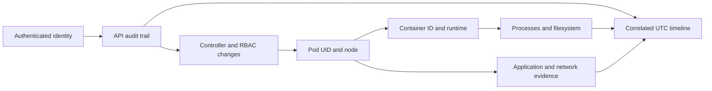

# Digital forensics and incident response in Kubernetes

Prepared **28 October 2026**. This guide is independent of the earlier container labs. The companion [Kubernetes DFIR lab](k8s-dfir-lab/README.md) turns the investigation workflow into a small, repeatable exercise.

## 1. Investigate the workload, its authority, and its host

A suspicious process in a Pod is only one part of a Kubernetes incident. Establish how that Pod was created, which identity can change it, what that identity can access, and whether the underlying node is affected. A replacement Pod can look normal while the controller that recreates it remains compromised.

Keep three working hypotheses separate:

1. **Application compromise:** requests or application behavior led to execution inside a container.
2. **API or identity compromise:** an identity used Kubernetes permissions to read data, execute commands, or change workloads.
3. **Node or control-plane compromise:** host-level authority could alter multiple workloads or undermine cluster evidence.

Evidence may support more than one hypothesis. Do not infer a container escape from a suspicious command, or infer stolen credentials from an unusual service-account name alone.

## 2. Evidence sources and their limits

| Source | Questions it helps answer | What it cannot establish alone |
|---|---|---|
| API audit records | Which identity requested which operation, against which object, with what result? | Every shell command or syscall after an interactive exec session begins |
| Resource JSON | Pod UIDs, owners, scheduling, image IDs, RBAC, volume mounts, security settings | A complete history of deleted or overwritten objects |
| Kubernetes Events | Scheduling, image pulls, restarts, reconciliation symptoms | An authoritative security audit history |
| Container stdout/stderr | Application requests, errors, deliberate application logging | Activity the application never logged or logs already removed |
| Runtime and kubelet state | Container lifecycle, sandbox identity, node correlation | Trustworthy history if the node itself is under attacker control |
| Container files and volumes | Dropped artifacts, application data, modified configuration | Original state after a writable layer or temporary volume is destroyed |
| Runtime sensors | Process, file, network, and policy events collected by the sensor | Historical events from before the sensor was running |
| Network/DNS/proxy telemetry | Destinations, timing, flows, sometimes requests | Cleartext payloads inside encrypted sessions |
| Cloud identity and platform logs | Human/cloud identity, node provisioning, registry and infrastructure changes | Kubernetes object-level detail absent from that logging source |

Prefer independent corroboration. An application log can be manipulated by application-level access. A node administrator may manipulate local files and logs. An exported audit stream controlled by a separate account offers a different trust boundary.

Container logs rotate. `kubectl logs` exposes the available current segment, and `--previous` addresses the previous container instance rather than an arbitrary historical archive. Preserve centralized logs and relevant node segments where available. [Kubernetes logging architecture](https://kubernetes.io/docs/concepts/cluster-administration/logging/).

## 3. Prepare before an incident

Agree on who can collect evidence, isolate workloads, revoke identities, and restore service. Inventory clusters, node pools, runtimes, CNI plugins, registries, and business owners. Define where evidence is stored and who can read it.

Enable audit logging deliberately. Select retention, export destinations, and alerting for failures. Exercise the policy with known requests and confirm that the expected records actually arrive. Protect sensitive bodies: logging every Secret or token response can create another sensitive data repository. [Kubernetes auditing](https://kubernetes.io/docs/tasks/debug/debug-cluster/audit/).

Retain deployment manifests, image digests, build provenance, admission decisions, RBAC changes, and identity-provider logs. Synchronize clocks and record clock offsets during acquisition. Decide whether snapshots are crash-consistent or application-consistent before treating them as a recovery source.

The lab enables audit output through the API server's container stdout using Minikube's documented file-sync mechanism. This is convenient for a short exercise; durable production retention should not depend on one API server container's local logs. [Minikube audit setup](https://minikube.sigs.k8s.io/docs/tutorials/audit-policy/).

## 4. Initial triage and preservation

Begin a case record with UTC time, investigator, cluster identity, report source, affected application, and known business impact. Capture the initial alert before it changes. Record both what is known and what is only suspected.

Use explicit cluster and namespace selection. Preserve object JSON before making changes. `kubectl get all` is insufficient: it omits important resources such as RBAC and ConfigMaps. The companion collector enumerates its intended resource types explicitly.

Prioritize volatile evidence based on the situation:

1. Running process and network state, short-lived runtime events, and immediately expiring logs.
2. Pod/container identity, controller ownership, current and previous logs, API audit events.
3. Writable layers, temporary volumes, persistent storage, node state, image provenance.
4. Cloud/platform, registry, CI/CD, and identity records for the wider time window.

Avoid restarting, deleting, draining, or rescheduling the suspect before deciding what must be preserved. If active harm requires immediate containment, record the action and the evidence loss it may cause. Service restoration and evidence preservation are competing operational needs, so make the tradeoff explicit.

Read operations can also leave traces. `exec`, diagnostic containers, and node inspection start processes or create API activity. Record command, start/end time, output, exit status, and investigator identity. Do not mistake the acquisition's own activity for the incident.

## 5. Identify the exact workload instance

Record these fields together:

| Object | Fields to preserve |
|---|---|
| Cluster | Provider/account, API endpoint identity, known cluster identifier |
| Namespace | Name and UID |
| Pod | Name, UID, creation time, node, IP, service account, ownerReferences |
| Container | Name, containerID, image reference, imageID, state, restartCount |
| Controller | Kind/name/UID, template, desired replicas, revisions, ownership chain |
| Storage | Mounts, volume type, PVC/PV identifiers, snapshot identifiers where used |

Names and IP addresses can recur. A name without a UID and time window can join evidence from different instances. Image tags can move; record the resolved runtime image ID and identify any difference between the image, writable layer, and mounted volume.

Follow ownership upward: a Pod may belong to a ReplicaSet and Deployment, or to a Job and CronJob. Removing a child does not remove its creator. For the lab, use the captured `resources.json` to follow the chain instead of relying only on the current live state.

## 6. Read the API audit trail carefully

Preserve original records and derive a separate timeline. Useful fields include `auditID`, timestamps, stage, `user`, `impersonatedUser`, verb, object reference, request URI, response status, source IPs, and user agent. Requested bodies appear only at a suitable audit level.

A request can have several stages with the same audit ID. Count requests separately from records. A denied operation demonstrates an attempted action within the visible logging scope; it does not demonstrate successful access. A successful exec upgrade establishes a session, not the successful completion of every program run through that session.

The lab's `Request` policy records selected mutations, while its first rule retains only metadata for Secret and token operations. Its normalizer preserves raw logs and produces one timeline row per audit ID, preferring the completed stage. [Audit event semantics](https://kubernetes.io/docs/tasks/debug/debug-cluster/audit/).

Impersonation requires special care. The training harness authenticates as the administrator and requests service-account impersonation. Preserve both identities. The effective identity explains authorization; the original identity explains who initiated that request. This lab does not demonstrate theft or use of an actual service-account token. [Kubernetes impersonation](https://kubernetes.io/docs/reference/access-authn-authz/authentication/#user-impersonation).

Source IPs and user agents are useful correlation fields, not conclusive attribution. Proxies, NAT, and client-supplied identifiers can affect what they mean.

## 7. Investigate processes, files, and the node

Use existing telemetry first. For live inspection, document how the tool reaches the target and how much it trusts the target's own binaries. A compromised container may provide misleading output from its own shell utilities.

`kubectl debug` can add an ephemeral container when the application lacks diagnostic tools. Targeted process-namespace access depends on the runtime. Its filesystem is separate from the application's filesystem; a visible target process and appropriate permissions may allow access through `/proc/<pid>/root`. Record the diagnostic image and all resulting changes. [Kubernetes debugging](https://kubernetes.io/docs/tasks/debug/debug-application/debug-running-pod/).

An archive of `/work` is a logical collection of that mounted directory, not a full disk image or memory acquisition. For broader investigations, separately scope image layers, writable layers, persistent volumes, and node storage. Record timestamps and filesystem semantics rather than assuming that a copied file retains every original attribute.

For node-level correlation, use the recorded node and container IDs with CRI tooling. `crictl` communicates with the node's runtime endpoint; its identifiers should be joined back to the Pod UID and container name. Runtime socket access is powerful, so use the established incident-response access path. [crictl documentation](https://kubernetes.io/docs/tasks/debug/debug-cluster/crictl/).

If host compromise is plausible, expand beyond the namespace: sibling workloads, node agents, privileged Pods, host mounts, node identity, cloud metadata access, and other nodes reached from it. The base lab does not simulate a host escape or full node compromise.

## 8. Containment without losing the investigation thread

Select containment based on the authority and communication path involved:

| Action | What to verify | Operational limit |
|---|---|---|
| Network isolation | Fresh connection attempts fail; destination/control path remains healthy | CNI enforcement, additive policies, and existing connections matter |
| Remove RBAC grant | A new request by the identity is denied | Other grants or already-open sessions can remain |
| Suspend CronJob | No new scheduled Jobs appear | Already-created Jobs continue independently |
| Cordon a node | Scheduler avoids new ordinary workloads there | Existing workloads continue; this is not network isolation |
| Replace affected workloads | New instance matches trusted desired state | Old evidence is destroyed unless preserved |
| Rotate/revoke identity | Old authority can no longer be exercised through relevant paths | Strategy depends on identity type and validation behavior |

NetworkPolicies combine their allowed traffic. Adding a deny policy does not cancel another policy's matching allow rule. The lab excludes quarantined Pods from its allow policy and tests fresh connections. That proves the specific tested path is blocked, not universal isolation from nodes or all control-plane mechanisms. [NetworkPolicy behavior](https://kubernetes.io/docs/concepts/services-networking/network-policies/).

Review permissions as a set: namespace Roles, ClusterRoles, bindings, impersonation, and workload-creation authority. Removing one binding does not establish that all equivalent authority is gone. [RBAC documentation](https://kubernetes.io/docs/reference/access-authn-authz/rbac/).

## 9. Recovery and reporting

Restore from reviewed source and known image identity, remove unauthorized controllers and grants, repair the entry condition, and validate application behavior. Watch for renewed requests or recreated artifacts. In a real incident, verify the entire affected scope before closing the case.

Keep raw acquisitions separate from analysis. Hash files at acquisition and verify them after transfer. A hash detects a change relative to the saved manifest; it does not prove the original source was truthful or prevent an attacker from replacing both file and manifest. Preserve a protected copy of the manifest and record transfers and access.

A useful report contains:

- Scope and affected object identities, with the exact time window.
- A timeline linking each material conclusion to an evidence file and identifier.
- Observations, interpretations, confidence, and plausible alternatives.
- Data accessed or transferred, distinguishing demonstrated access from possible exposure.
- Containment and recovery actions, their verification, and evidence they destroyed.
- Collection gaps, retention limits, clock uncertainty, and remaining questions.

## 10. Adapting the approach to managed clusters

Managed control planes generally require provider logging interfaces instead of the lab's `kubectl logs` approach. For EKS, check whether the `audit` control-plane log type was enabled and exported to CloudWatch during the incident window. Enabling it later does not create past events. [EKS control-plane logging](https://docs.aws.amazon.com/eks/latest/userguide/control-plane-logs.html).

For AKS, inspect the configured diagnostic categories and destinations, including audit-related categories, and preserve the actual retention configuration. Correlate platform changes with the Azure identity and activity records relevant to the case. [AKS monitoring reference](https://learn.microsoft.com/en-us/azure/aks/monitor-aks-reference).

Use the [lab walkthrough](k8s-dfir-lab/LAB_GUIDE.md) to practice the evidence joins and limits on a small cluster before adapting them to production access, retention, and response procedures.
